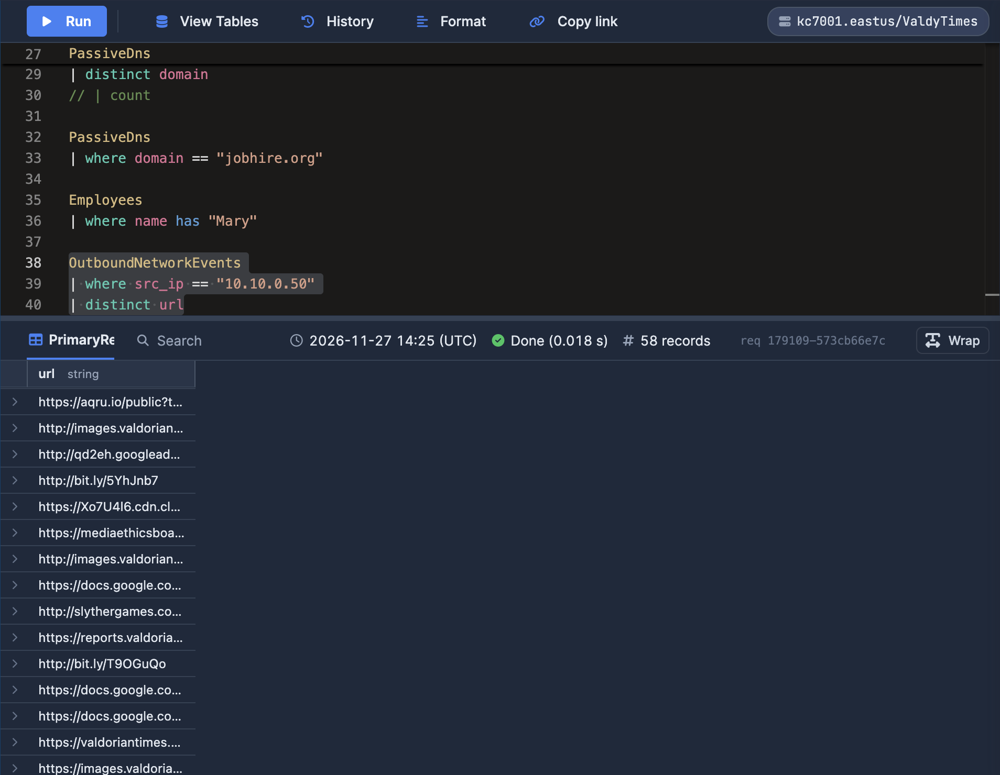

# Q10

**Pertanyaan:** How many distinct websites did employees with the first name "Mary" Visit?

**Cara penyelesaian:**
Cari dulu IP employee bernama Mary:
```kql
Employees
| where name has "Mary"
```
Baru cek website yang dikunjungi dari IP tersebut:
```kql
OutboundNetworkEvents
| where src_ip == "10.10.0.50"
| distinct url
```


**Jawaban:** 58
