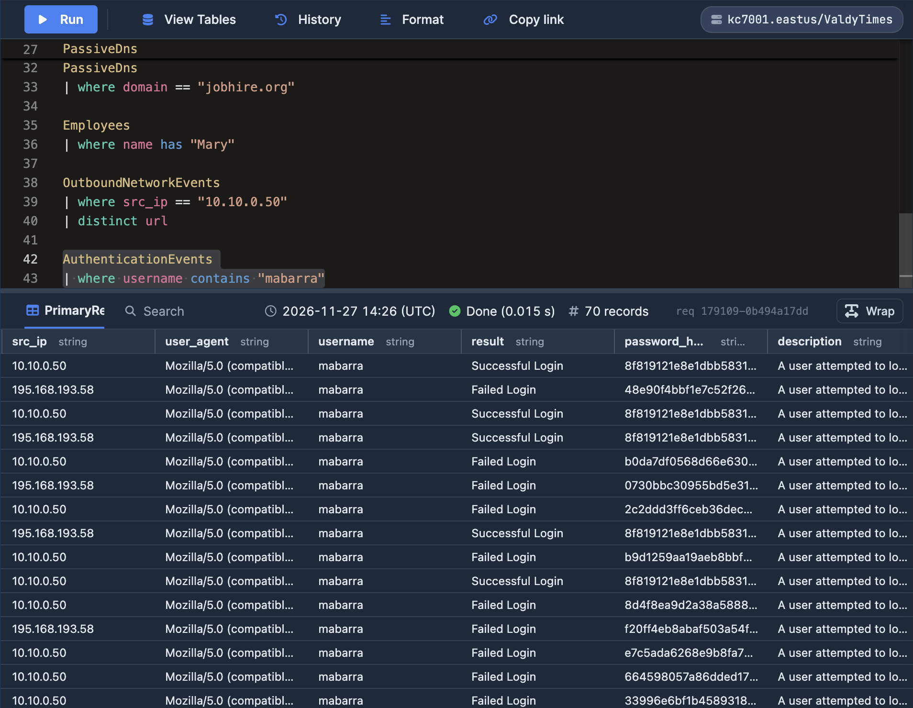

# Q11

**Pertanyaan:** How many authentication attempts did we see to the accounts of employees with the first name Mary?

**Konteks:**
⚠️ Dari hasil query, keliatan ada 2 src_ip yang beda buat username `mabarra`: `10.10.0.50` (IP internal/normal) dan `195.168.193.58` (IP eksternal, mencurigakan) — campuran successful & failed login dari kedua IP ini jadi indikasi awal ada yang coba brute-force/login dari luar.

**Cara penyelesaian:**
```kql
AuthenticationEvents
| where username contains "mabarra"
```


**Jawaban:** 70
