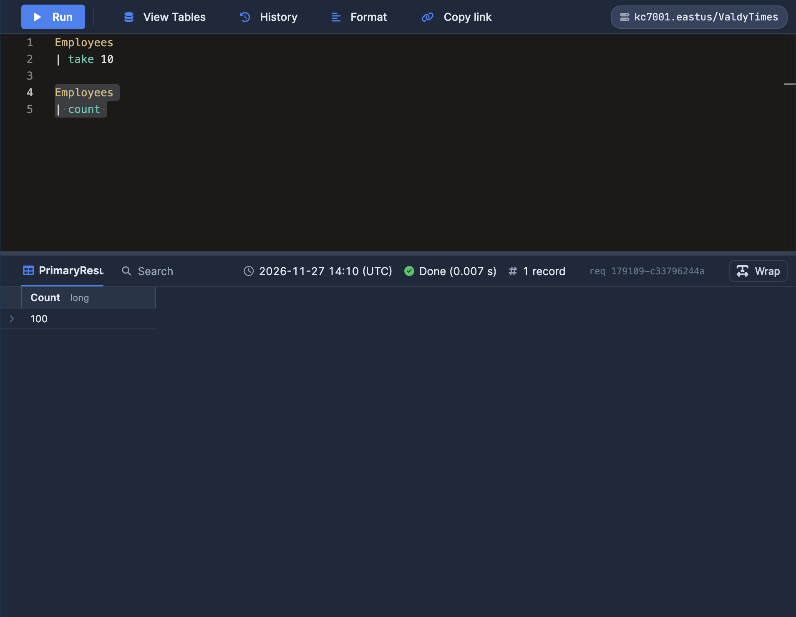

# Q3

**Pertanyaan:** How many employees work at the Valdorian Times?

**Konteks:**
Sekarang udah ada akses ke data, saatnya dapetin gambaran umum soal The Valdorian Times.

**Cara penyelesaian:**
```kql
Employees
| count
```


**Jawaban:** 100
