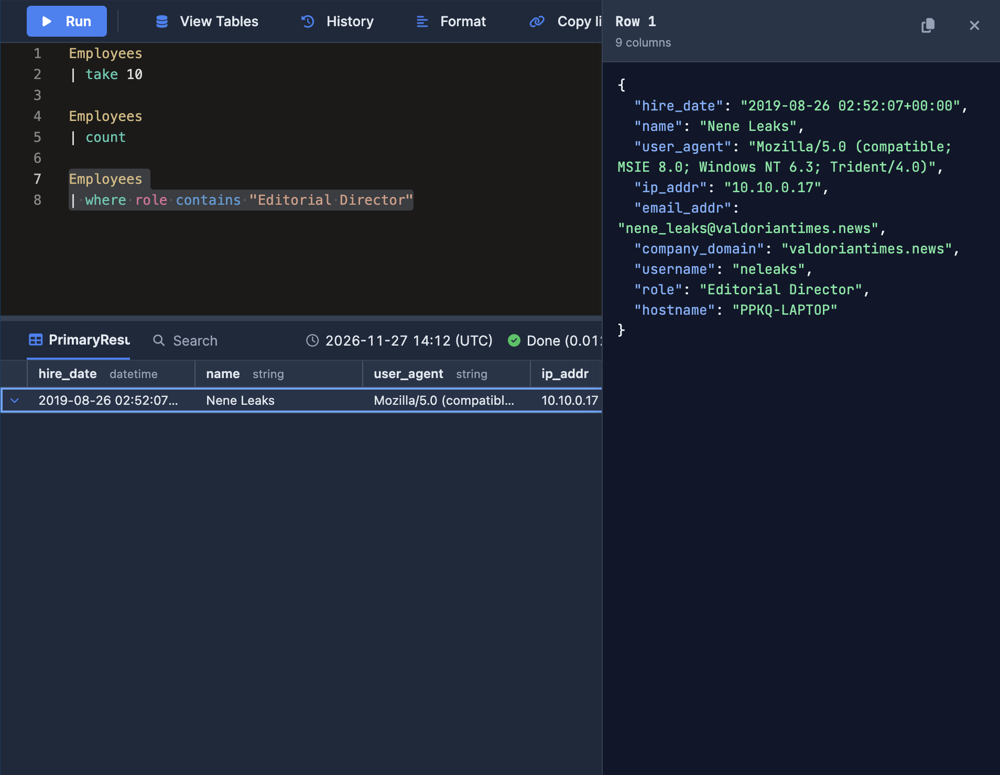

# Q4

**Pertanyaan:** What is the Editorial Director's name?

**Konteks:**
Bisa pakai operator `where` di table `Employees` buat nyari employee tertentu. Template-nya:
```kql
Table
| where field operator value
```

**Cara penyelesaian:**
```kql
Employees
| where role contains "Editorial Director"
```


**Jawaban:** Nene Leaks
