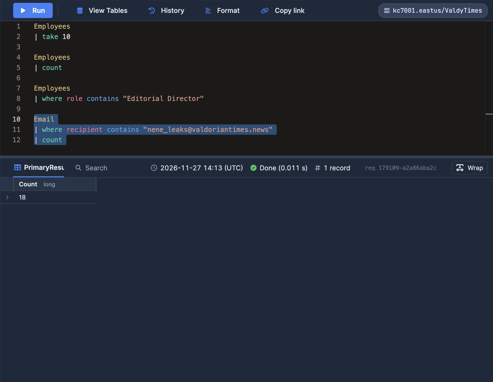

# Q5

**Pertanyaan:** How many emails did Nene Leaks receive?

**Konteks:**
Bisa gali lebih dalam soal Nene Leaks pakai informasi dari table lain — ambil email address-nya dari table `Employees`, terus pakai buat query ke table `Email`.

**Cara penyelesaian:**
```kql
Email
| where recipient contains "nene_leaks@valdoriantimes.news"
| count
```


**Jawaban:** 18
