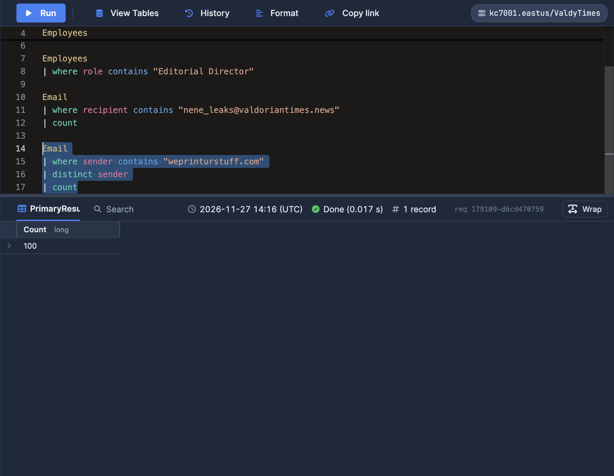

# Q6

**Pertanyaan:** How many distinct senders were seen in the email logs from the domain name "weprinturstuff.com"?

**Konteks:**
Operator `distinct` bisa dipakai buat nyari unique value di kolom tertentu.

**Cara penyelesaian:**
```kql
Email
| where sender contains "weprinturstuff.com"
| distinct sender
| count
```


**Jawaban:** 100
