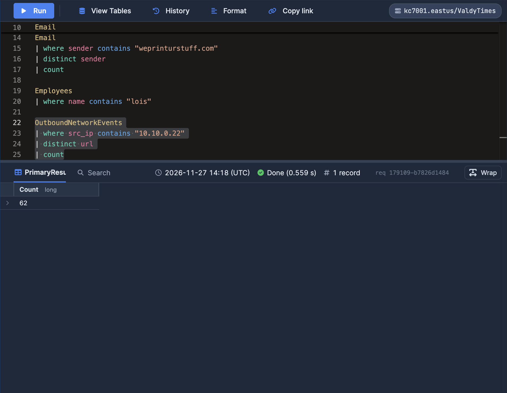

# Q7

**Pertanyaan:** How many distinct URLs did "Lois Lane" visit?

**Cara penyelesaian:**
Cari dulu IP address Lois Lane dari table `Employees`:
```kql
Employees
| where name contains "lois"
```
Baru query `OutboundNetworkEvents` pake IP tadi:
```kql
OutboundNetworkEvents
| where src_ip contains "10.10.0.22"
| distinct url
| count
```


**Jawaban:** 62
