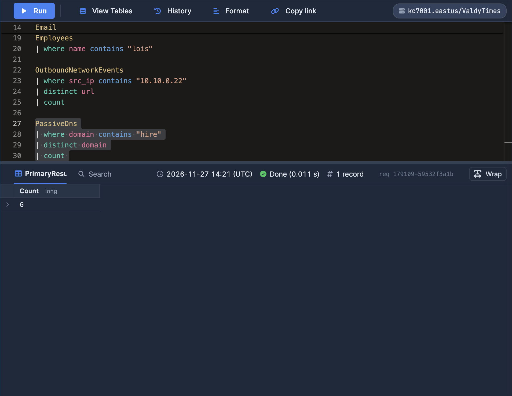

# Q8

**Pertanyaan:** How many distinct domains in the PassiveDns records contain the word "hire"?

**Cara penyelesaian:**
```kql
PassiveDns
| where domain contains "hire"
| distinct domain
| count
```


**Jawaban:** 6
