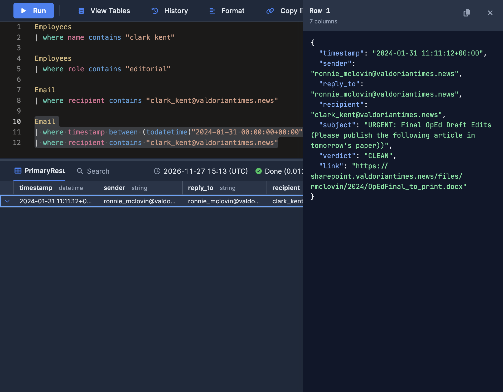

# Q5

**Pertanyaan:** What was the subject line of this email?

**Konteks:**
Review email yang dikirim ke Clark Kent, yang dikirim tanggal 31 Januari 2024, berisi final edits buat election OpEd.

**Cara penyelesaian:**
```kql
Email
| where timestamp between (todatetime("2024-01-31 00:00:00+00:00") .. todatetime("2024-02-01 00:00:00+00:00"))
| where recipient contains "clark_kent@valdoriantimes.news"
```


⚠️ Email ini terkirim dari `ronnie_mclovin@valdoriantimes.news` (email asli Ronnie, verdict **CLEAN**), lampirannya link ke `sharepoint.valdoriantimes.news/files/rmclovin/2024/OpEdFinal_to_print.docx` — padahal Ronnie sendiri ngaku gak pernah ngirim email ini. Indikasi kuat akun email Ronnie dipakai/dikendalikan orang lain (account takeover) buat ngirim draft palsu.

**Jawaban:** URGENT: Final OpEd Draft Edits (Please publish the following article in tomorrow's paper))
