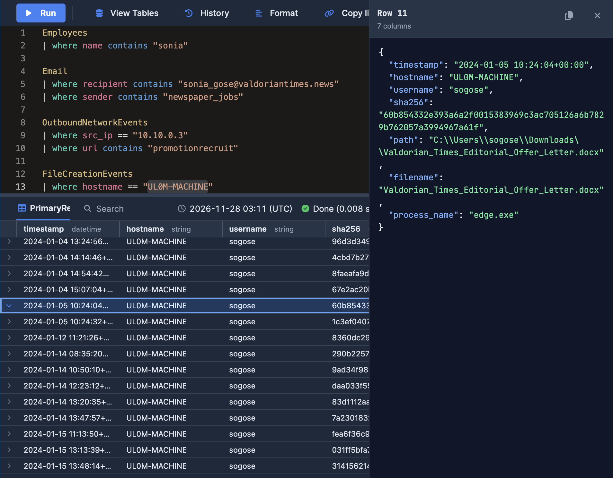

# Q11

**Pertanyaan:** What is the sha256 hash of the file that Sonia downloaded?

**Konteks:**
Hash itu string yang uniquely merepresentasikan isi sebuah file. Kita bisa dapetin hash file dengan nge-run lewat hashing algorithm. Untungnya, hash dari semua file yang di-download udah ke-capture.

**Cara penyelesaian:** Lihat kolom `sha256` dari hasil query di [Q9](./q9.md).

**Jawaban:** 60b854332e393a6a2f0015383969c3ac705126a6b7829b762057a3994967a61f
