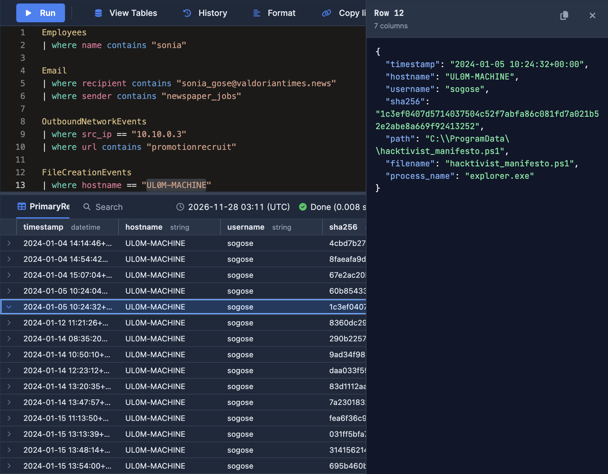

# Q12

**Pertanyaan:** What is the name of the file (.ps1) that was written to disk immediately after the docx was downloaded?

**Konteks:**
Setelah file berbahaya didownload, file itu mulai mengeksekusi konten berbahaya 🪲. Lanjut kita lihat lagi mesin Sonia.

**Cara penyelesaian:**
```kql
FileCreationEvents
| where hostname == "UL0M-MACHINE"
```


⚠️ File ini ditulis di `C:\ProgramData\hacktivist_manifesto.ps1` oleh proses `explorer.exe` — nama file & pola persistence yang sama kayak insiden phishing Nene Leaks di Section 1, indikasi serangan dari aktor/toolkit yang sama.

**Jawaban:** hacktivist_manifesto.ps1
