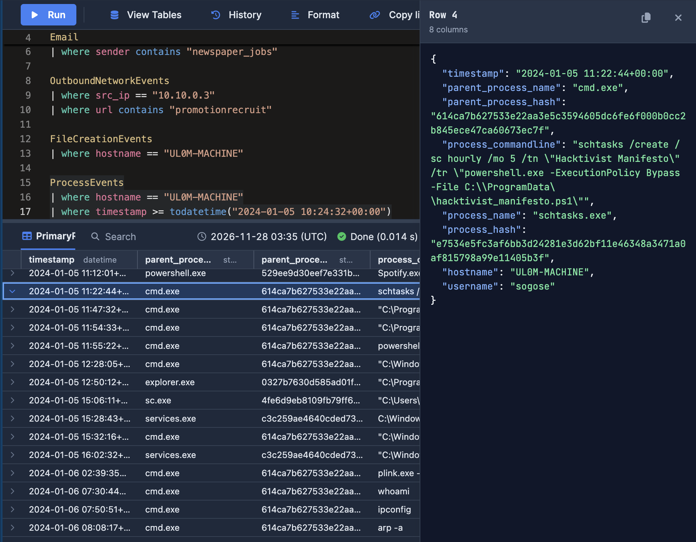

# Q19

**Pertanyaan:** What is the full command used to create the scheduled task?

**Konteks:**
Salah satu proses ternyata pakai `schtasks.exe`, yang bikin scheduled task. Scheduled task bisa dipakai buat ngejalanin aksi tertentu secara berkala.

**Cara penyelesaian:** Lihat kolom `process_commandline` dari hasil query di [Q18](./q18.md) yang pakai `schtasks`.

**Jawaban:** schtasks /create /sc hourly /mo 5 /tn "Hacktivist Manifesto" /tr "powershell.exe -ExecutionPolicy Bypass -File C:\ProgramData\hacktivist_manifesto.ps1"
