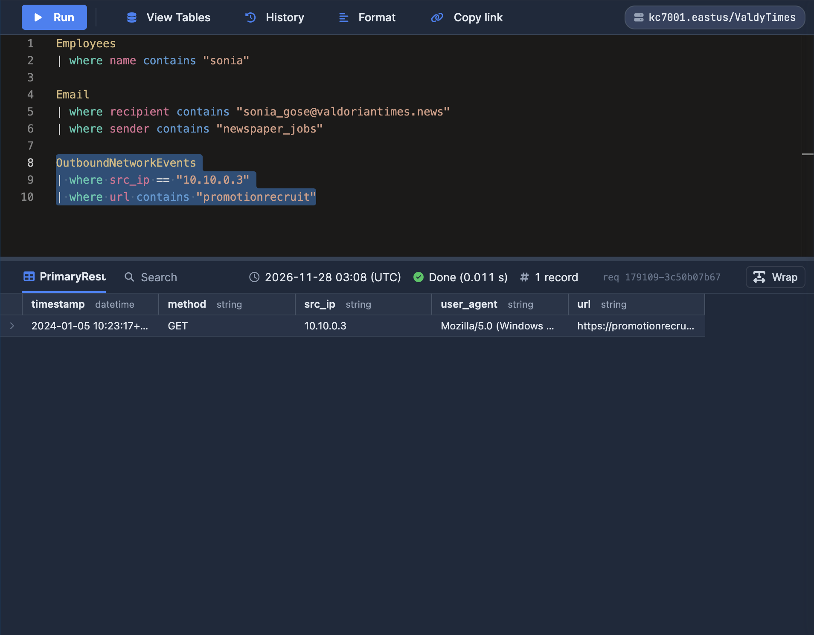

# Q6

**Pertanyaan:** Did Sonia click on this link? If so, enter the timestamp when she clicked the link. If not, type "no".

**Cara penyelesaian:**
```kql
OutboundNetworkEvents
| where src_ip == "10.10.0.3"
| where url contains "promotionrecruit"
```


**Jawaban:** 2024-01-05 10:23:17+00:00
