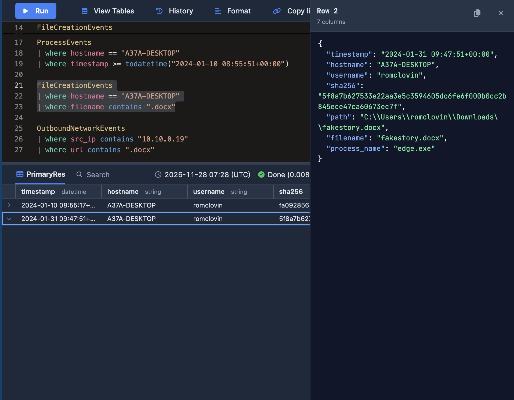

# Q16

**Pertanyaan:** What is the sha256 hash of fakestory.docx on Ronnie's machine?

**Cara penyelesaian:**
```kql
FileCreationEvents
| where hostname == "A37A-DESKTOP"
| where filename contains "fakestory.docx"
```


**Jawaban:** 5f8a7b627533e22aa3e5c3594605dc6fe6f000b0cc2b845ece47ca60673ec7f
