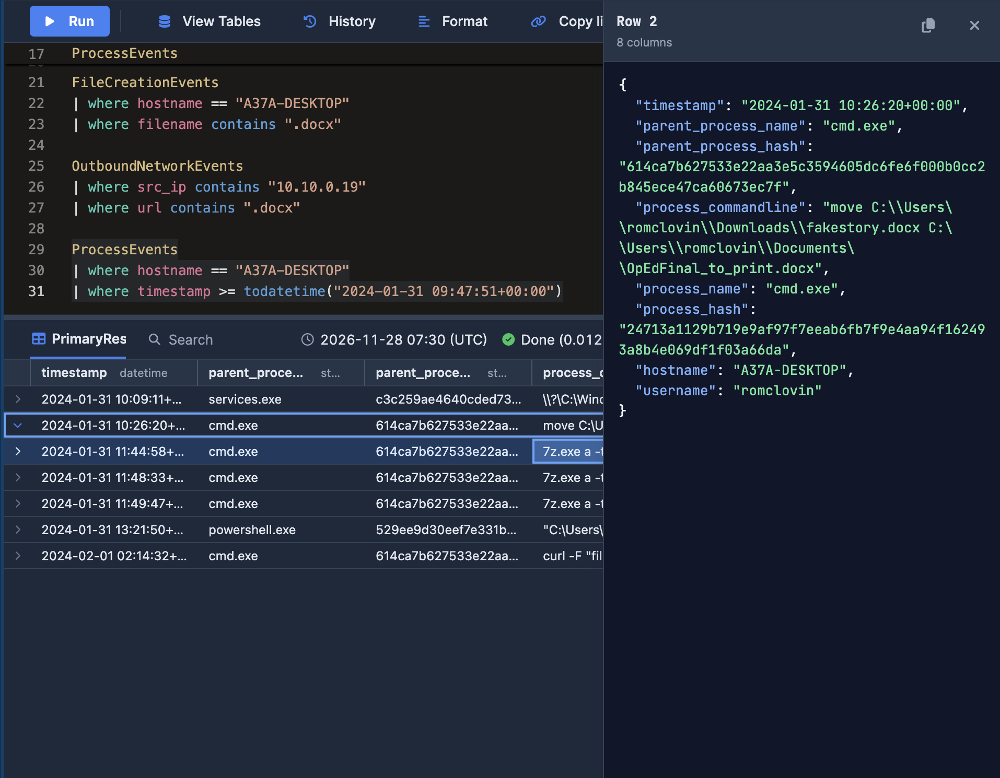

# Q18

**Pertanyaan:** What is the new path for the document?

**Konteks:**
Ronnie gak inget pernah liat file itu atau ngunjungin domain itu. Keliatannya download file ini adalah bukti hands-on-keyboard activity dari attacker.

Lihat apa yang attacker lakuin setelah download `fakestory.docx` lewat `ProcessEvents` di mesin Ronnie.

Setelah download `fakestory.docx`, attacker ngejalanin command buat rename dan mindahin file-nya ke lokasi lain.

**Cara penyelesaian:**
```kql
ProcessEvents
| where hostname == "A37A-DESKTOP"
| where process_commandline contains "fakestory.docx"
```


🔥 **Confirmed!** File-nya di-rename jadi `OpEdFinal_to_print.docx` — nama file **persis sama** kayak yang dilampirkan di email "URGENT: Final OpEd Draft Edits..." ke Clark Kent (Section 2). Ini bukti pasti: attacker yang nulis `fakestory.docx`, rename jadi draft OpEd palsu, terus kirim dari akun Ronnie yang udah dia kuasai.

**Jawaban:** C:\\Users\\romclovin\\Documents\\OpEdFinal_to_print.docx
