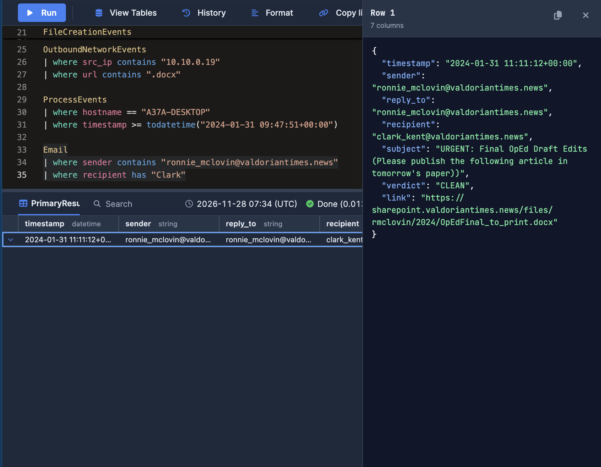

# Q20

**Pertanyaan:** When was OpEdFinal_to_print.docx emailed from Ronnie's account to Clark Kent?

**Konteks:**
OpEdFinal... kayaknya familiar. Tunggu dulu, itu nama file yang sama kayak yang keliatan di log email pas kita cari email Ronnie ngirim draft ke Clark Kent (Section 2). Mungkin gak attacker pakai email Ronnie buat ngirim file ini ke Clark?

**Cara penyelesaian:**
```kql
Email
| where sender contains "ronnie_mclovin@valdoriantimes.news"
| where recipient contains "clark_kent@valdoriantimes.news"
```


Timestamp-nya sama persis kayak yang udah ditemuin di [Section 2 Q5](../section-2-the-investigation-begins/q5.md) — **confirmed**, attacker yang kirim email ini pake akun Ronnie yang udah dia kuasai sejak RCE 2024-01-10.

**Jawaban:** 2024-01-31 11:11:12+00:00
