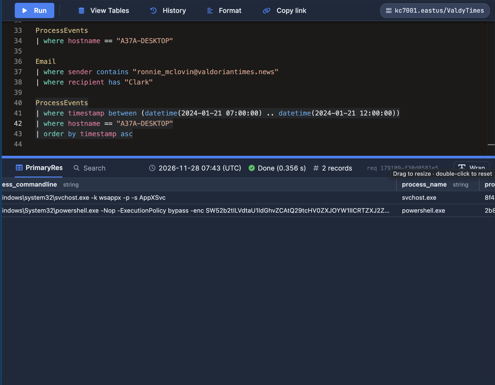

# Q25

**Pertanyaan:** How many total commands were run in this timeframe?

**Konteks:**
Oh no! Keliatannya ada yang nyolong meme-nya Ronnie dari mesinnya! Coba kita cari bukti attacker nyolong data. Bisa timebound analisisnya buat nemuin aksi lain yang terjadi di waktu yang sama pake query:
```kql
ProcessEvents
| where timestamp between (datetime(2024-01-21 07:00:00) .. datetime(2024-01-21 12:00:00))
| where hostname == "A37A-DESKTOP"
| order by timestamp asc
```

**Cara penyelesaian:** Lihat jumlah baris hasil query.


Ada 2 command: `svchost.exe -k wsappx -p -s AppXSvc` (normal/background) dan satu command `powershell.exe -Nop -ExecutionPolicy bypass -enc <base64>` — encoded PowerShell command, klasik teknik buat nyembunyiin command exfiltration/berbahaya dari log biasa.

**Jawaban:** 2
