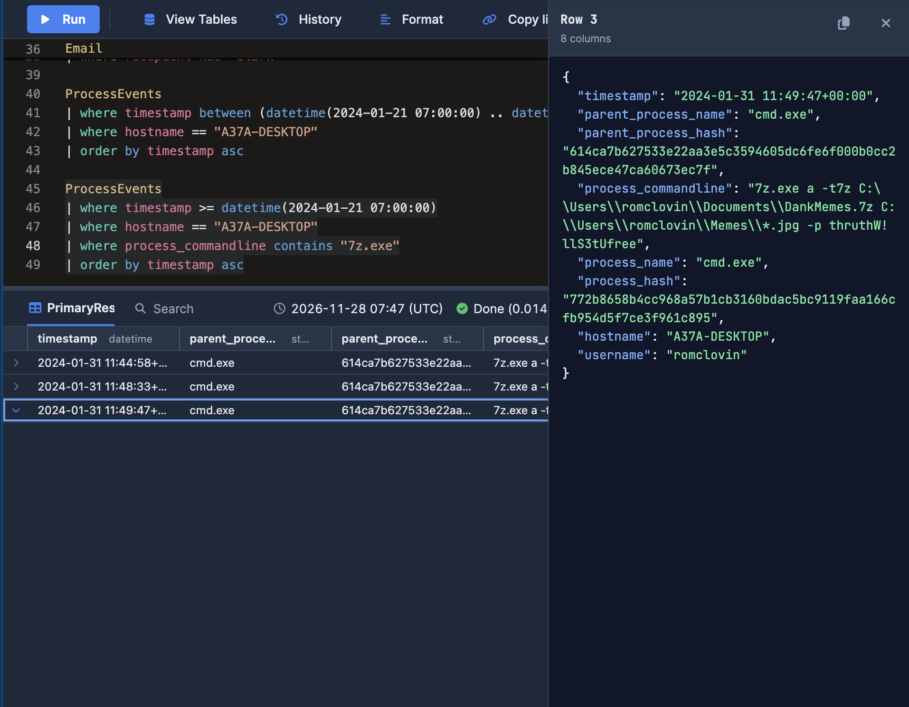

# Q26

**Pertanyaan:** What is the name of the .7z file that contains the stolen memes?

**Konteks:**
Persis setelah rename `fakestory.docx` jadi `OpEdFinal_to_print.docx`, attacker ngejalanin command buat nyolong (exfiltrate) data dari mesin Ronnie.

Salah satu command-nya pake 7zip buat compress semua meme lucu Ronnie jadi file `.7z`.


**Cara penyelesaian:**
```kql
ProcessEvents
| where timestamp >= datetime(2024-01-21 07:00:00)
| where hostname == "A37A-DESKTOP"
| where process_commandline contains "7z.exe"
| order by timestamp asc
```


Command lengkapnya: `7z.exe a -t7z C:\Users\romclovin\Documents\DankMemes.7z C:\Users\romclovin\Memes\*.jpg -p thruthW!llS3tUfree` (pake password yang sama kayak plink — sekali lagi konfirmasi aktor yang sama).

**Jawaban:** DankMemes.7z
