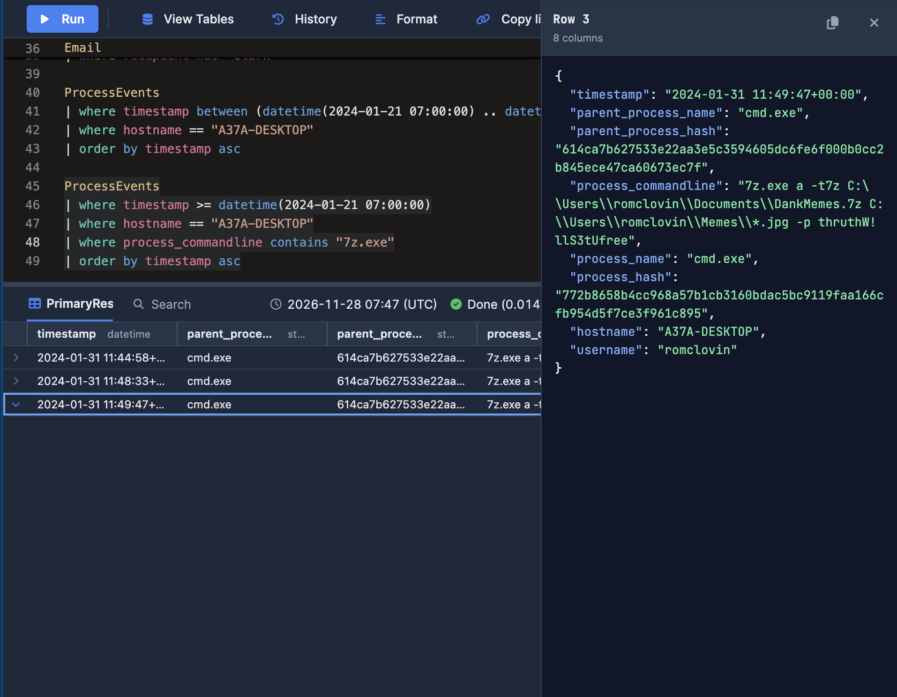
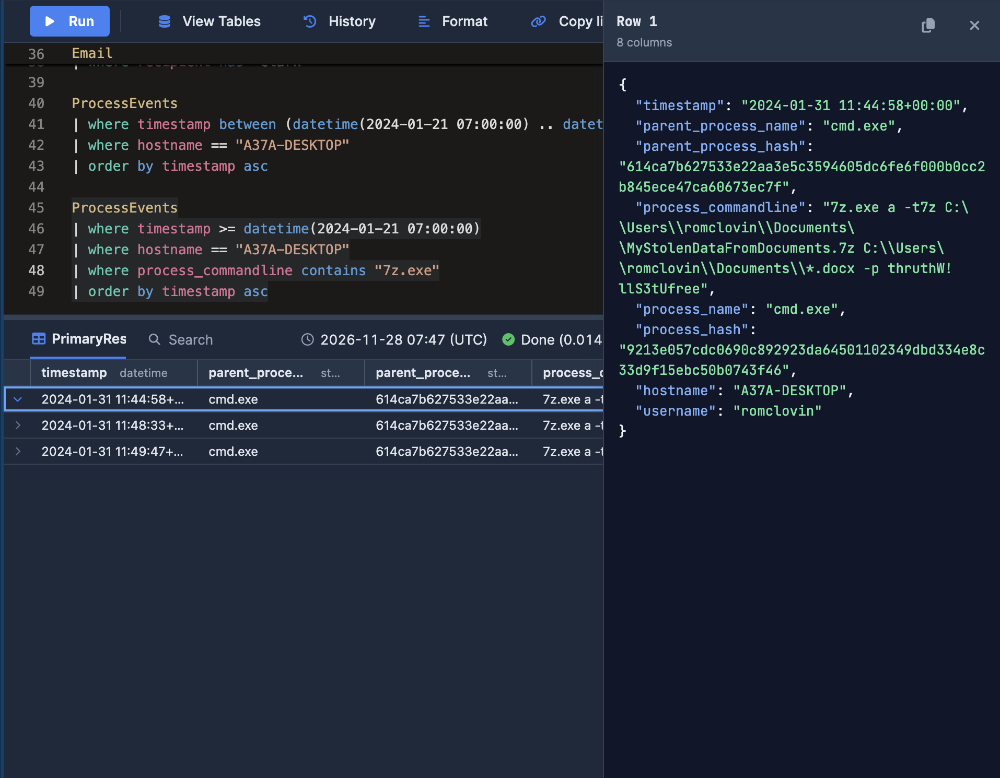
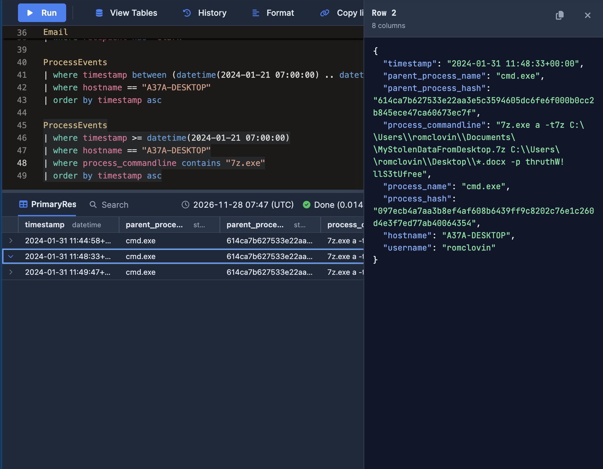

# Q29

**Pertanyaan:** What is the password the attackers used to encrypt all of the .7z files?

**Cara penyelesaian:** Lihat flag `-p` di command line 7zip dari hasil query di [Q26](./q26.md), [Q27](./q27.md), [Q28](./q28.md) — semuanya pake password yang sama.

⚠️ Password yang sama persis kayak yang dipake plink buat RCE — bukti kuat satu aktor/toolkit yang sama di balik semua aksi ini.

**Jawaban:** thruthW!llS3tUfree
