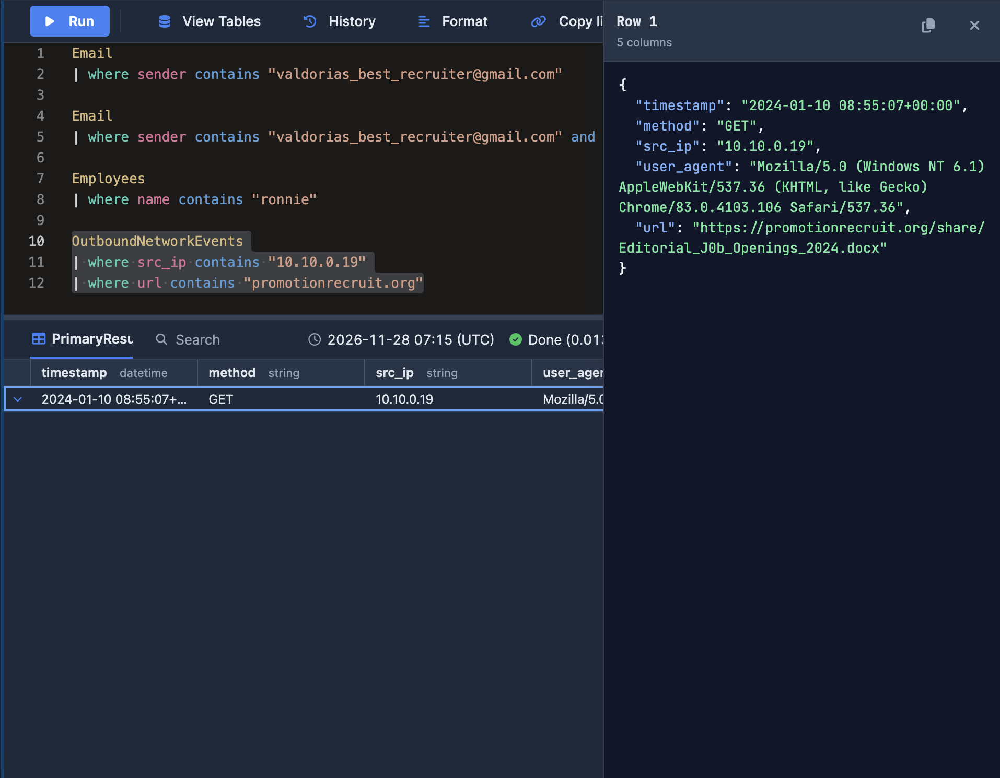

# Q5

**Pertanyaan:** When did Ronnie click on the link in the email from valdorias_best_recruiter@gmail.com?

**Konteks:**
Sama kayak yang dilakuin ke Sonia sebelumnya, sekarang kita perlu cek apa Ronnie klik link itu.

**Cara penyelesaian:**
Cari dulu IP address Ronnie:
```kql
Employees
| where name contains "ronnie"
```
Baru cek outbound traffic-nya:
```kql
OutboundNetworkEvents
| where src_ip contains "10.10.0.19"
| where url contains "promotionrecruit.org"
```


⚠️ Nama file docx di link yang diklik Ronnie: `Editorial_J0b_Openings_2024.docx` (pake angka nol di "J0b") — beda nama file sama yang diklik Sonia (`Valdorian_Times_Editorial_Offer_Letter.docx`), tapi domain & pola serangannya sama.

**Jawaban:** 2024-01-10 08:55:07+00:00
