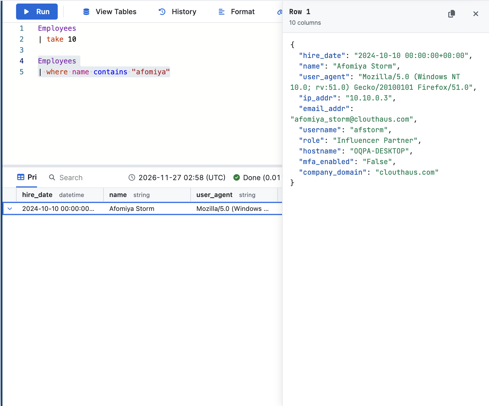

# Q1

**Pertanyaan:** Based on Afomiya's Instagram profile, what is the email address she uses for brand deals?

**Konteks:**
Afomiya Storm, 25 tahun, rising social media influencer di Washington D.C., kerja di fashion & lifestyle industry (konten "Get Ready With Me", "Day in My Life", sponsored brand collab). Dia pake email pribadi buat business inquiries di bio Instagram-nya, biar gampang dihubungin brand partner — tapi ini kebuka approach yang bisa expose dia ke lebih banyak risiko dari yang dia sadar.


**Cara penyelesaian:**
Query awal buat liat data Afomiya di `Employees`:
```kql
Employees
| where name contains "afomiya"
```


⚠️ **Tricky:** hasil query `Employees` nunjukin email kerjanya, `afomiya_storm@clouthaus.com` — tapi itu BUKAN jawaban yang diminta. Pertanyaannya spesifik nanya email yang dia pajang di **bio Instagram** buat brand deals, yaitu email pribadinya, kebaca langsung dari gambar profil Instagram.

**Jawaban:** afomiya_storm@gmail.com
