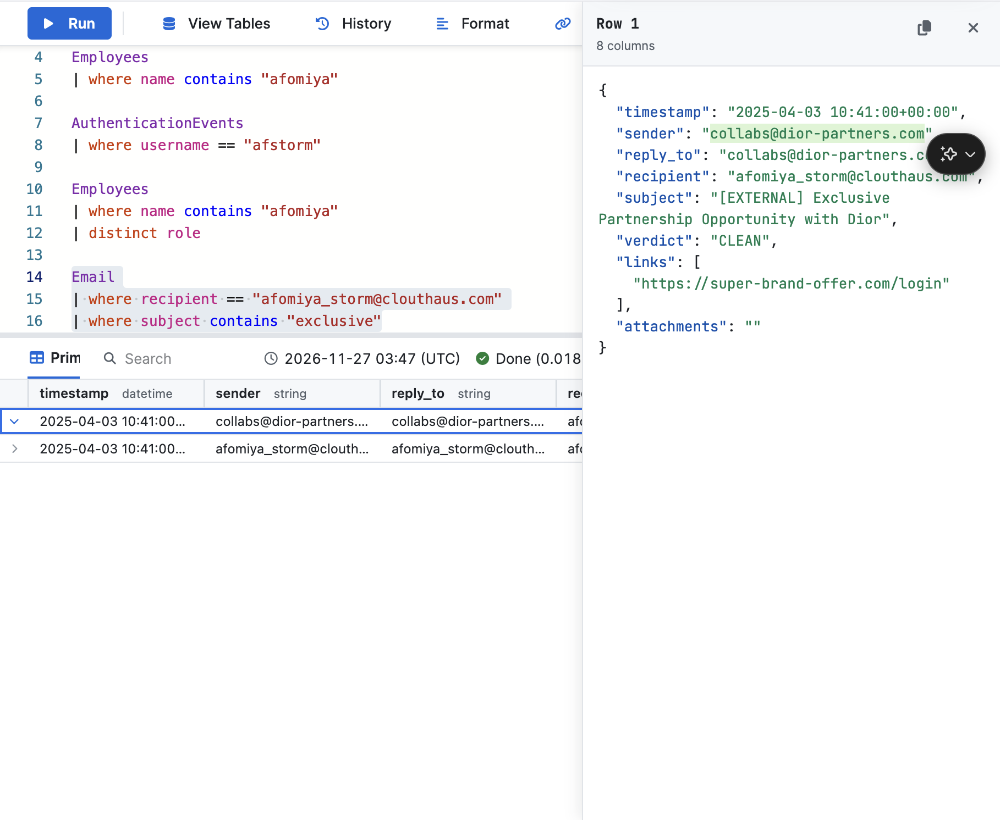

# Q10

**Pertanyaan:** What is the subject line of the email Afomiya received from "Dior"?

**Konteks:**
Subject line bisa banyak ngasih clue — kadang genuine, kadang cuma buat narik perhatian. Catatan penting: corporate system sering nambahin `[EXTERNAL]` di subject kalau email datang dari luar organisasi. Personal inbox (Gmail) gak nambahin ini — jadi kalau Afomiya liat email ini di brand email-nya, kemungkinan udah di-flag; tapi kalau di akun pribadi, gak bakal keflag.

**Cara penyelesaian:** Lihat kolom `subject` dari email "Dior" yang sama kayak [Q9](./q9.md).

**Jawaban:** [EXTERNAL] Exclusive Partnership Opportunity with Dior
