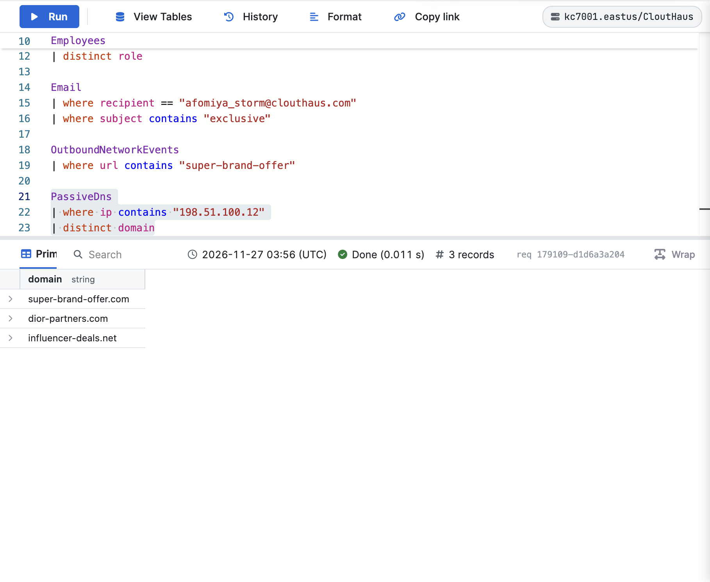

# Q15

**Pertanyaan:** How many distinct domains are linked to the suspicious IP address?

**Konteks:**
IP address itu kayak alamat rumah digital — kalau banyak domain mencurigakan nangkring di IP yang sama, kemungkinan itu "hacker hangout"/malicious infrastructure. Walau domain jahatnya udah lama hilang, PassiveDNS tetep nyimpen jejaknya.

**Cara penyelesaian:**
```kql
PassiveDns
| where ip contains "198.51.100.12"
| distinct domain
```


**Jawaban:** 3
