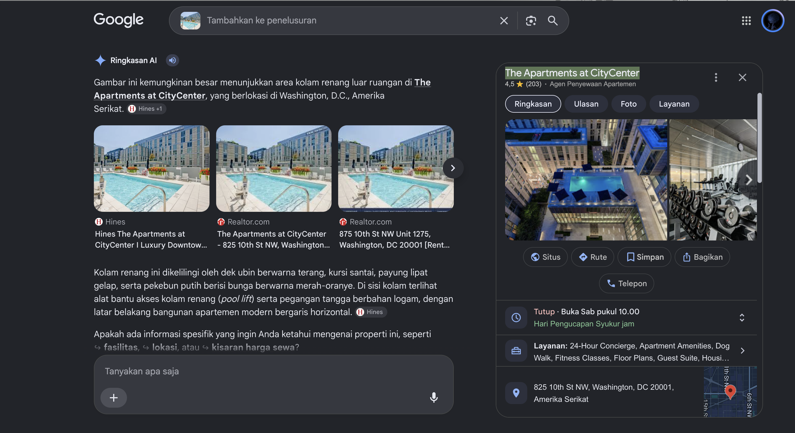

# Q18

**Pertanyaan:** Based on the images showing the apartment view and amenities from Afomiya's Instagram post, use a reverse image search to identify the name of the apartment building.

**Konteks:**
Attacker juga respon brand deal, ngaku apartment Afomiya cocok buat package deliveries. Attacker tau alamatnya dari postingan Instagram Afomiya yang nunjukin pemandangan apartment-nya — pake OSINT technique (reverse image search) buat pinpoint lokasi persisnya. Image: https://kc7photos-cfhbcabpaxb2f8fn.z03.azurefd.net/photos/Rooftop.jpg

**Cara penyelesaian:** Reverse image search foto rooftop/amenities dari postingan Instagram Afomiya.

**Jawaban:** The Apartments at CityCenter
