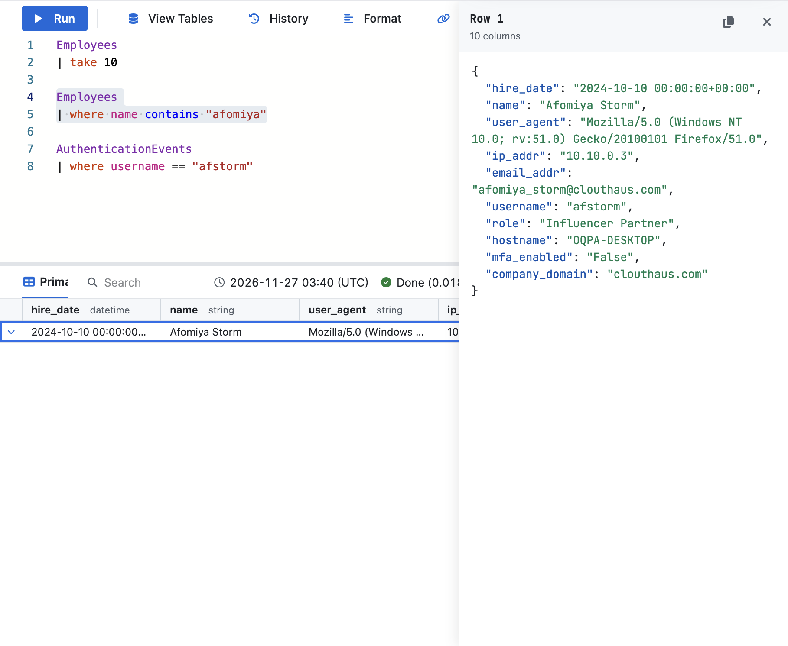

# Q6

**Pertanyaan:** According to CloutHaus internal employee logs, what is Afomiya's designated professional email?

**Konteks:**
Afomiya sekarang resmi gabung CloutHaus (brand management company), inbox-nya jadi bagian dari internal system CloutHaus. Semua aktivitas (email, network) dicatat di platform analitik Azure Data Explorer (ADX), diquery pakai KQL.

**Cara penyelesaian:**
```kql
Employees
| where name contains "afomiya"
```


**Jawaban:** afomiya_storm@clouthaus.com
