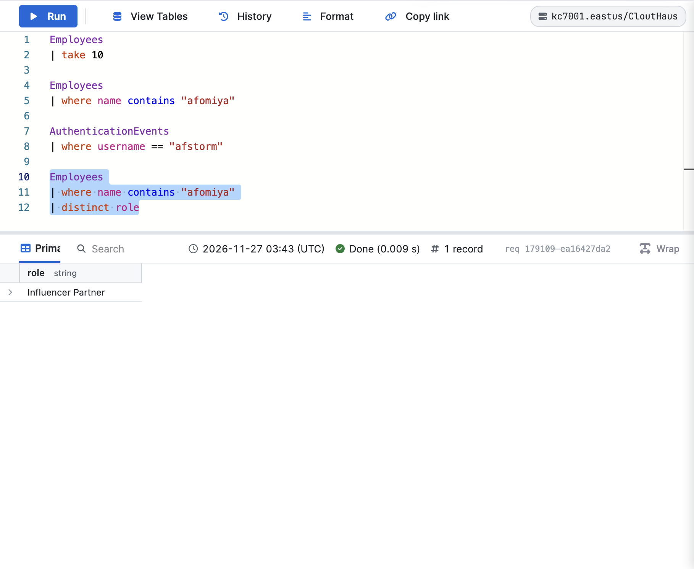

# Q7

**Pertanyaan:** What is Afomiya's role with CloutHaus?

**Konteks:**
Role employee penting buat tau siapa punya akses ke apa, siapa yang bisa jadi target, dan gimana caranya. Role nentuin sistem/data/privilege yang disentuh employee — jadi bagian dari attack surface. Threat actor pake info ini pas recon buat milih target high-value, bikin phishing lure yang meyakinkan, atau nyamar jadi orang terpercaya.

**Cara penyelesaian:**
```kql
Employees
| where name contains "afomiya"
| distinct role
```


**Jawaban:** Influencer Partner
