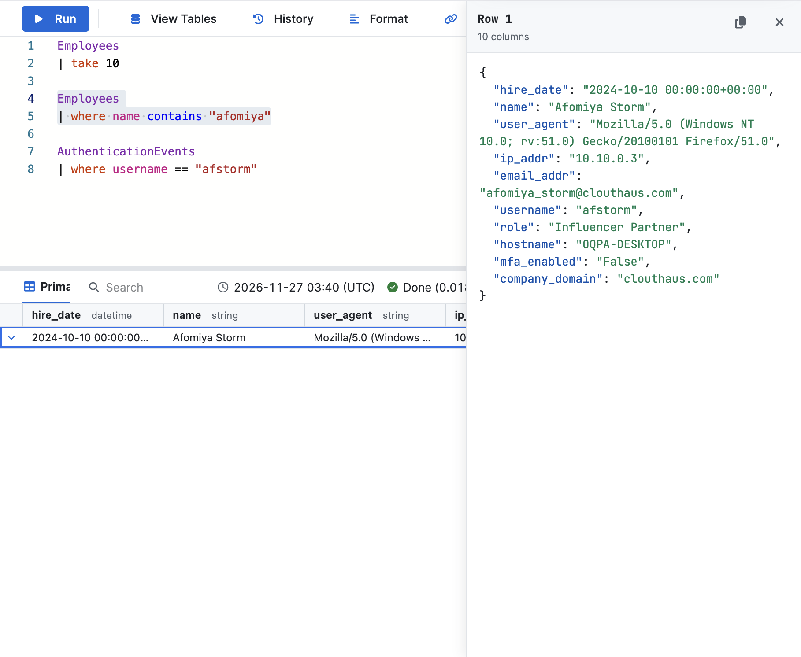

# Q8

**Pertanyaan:** Based on the CloutHaus employee table, what is the status of Multi-Factor Authentication (MFA) for Afomiya's account?

**Konteks:**
MFA itu kayak "bouncer digital" — meski password dicuri, attacker masih butuh second pass buat masuk. Buat public figure kayak Afomiya, MFA wajib karena jadi prime target phishing/password leak/account takeover.

**Cara penyelesaian:**
```kql
Employees
| where name contains "afomiya"
| distinct mfa_enabled
```


**Jawaban:** False (MFA gak aktif di akun CloutHaus-nya)
