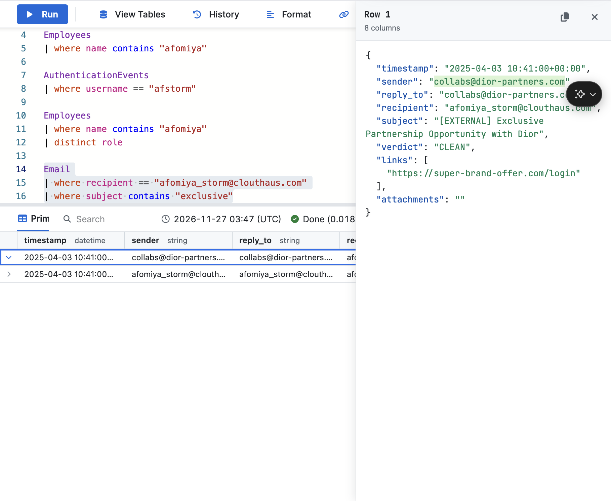

# Q9

**Pertanyaan:** What is the sender's email address in the email Afomiya received from "Dior"?

**Konteks:**
Email "exclusive partnership" dari Dior masuk ke inbox Afomiya — logo crisp, pesan personalized, keliatan legit banget. Tapi ada yang janggal: sender email address-nya.

**Cara penyelesaian:**
```kql
Email
| where recipient == "afomiya_storm@clouthaus.com"
| where subject contains "dior" or links contains "dior"
```


**Jawaban:** collabs@dior-partners.com
