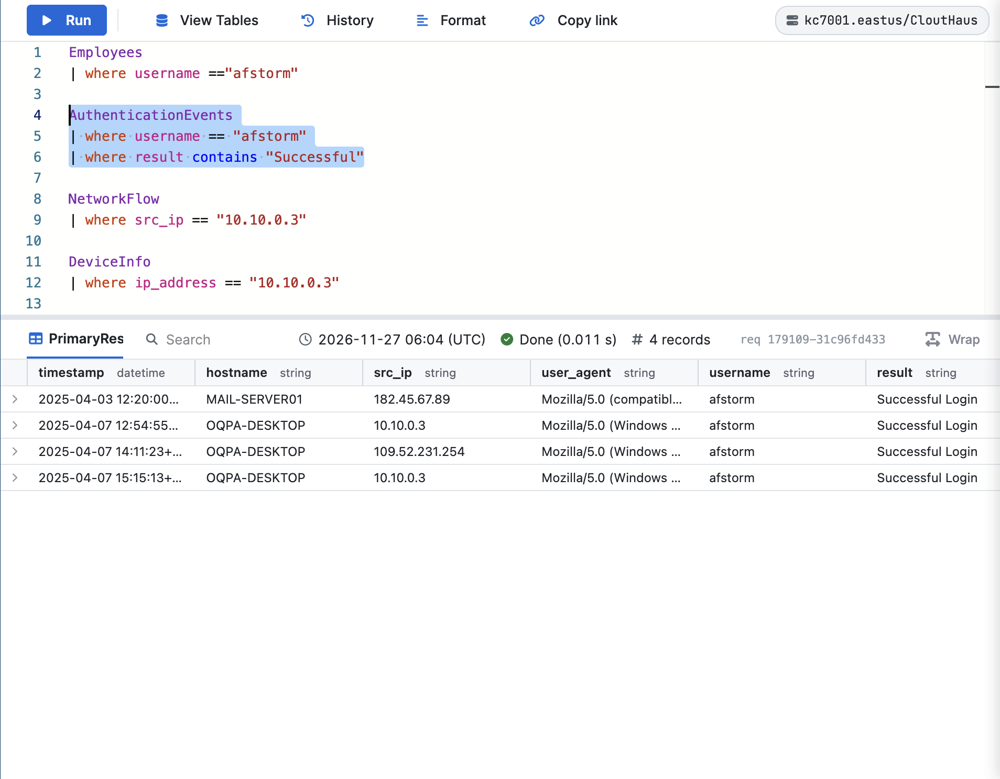

# Q1

**Pertanyaan:** What IP address was used to gain access?

**Konteks:**
1 jam setelah Afomiya klik link phishing ([Section 1 Q12](../section-1-got-clout/q12.md)), ada orang login ke email kerjanya — device beda, negara beda, pake Internet Explorer versi lama banget. Ini bukan sekadar snooping biasa — ini email compromise, recon, dan kemungkinan data theft. Tugas: pake log Authentication, Network, Email buat lacak apa yang dilakuin intruder, apa yang dia mau, dan apa yang mungkin ilang.

**Cara penyelesaian:** Cari event login mencurigakan, identifikasi IP yang dipake buat akses.

⚠️ **Catatan:** Ada 2 IP berbeda yang kena highlight di log ini. Aku pilih `182.45.67.89` karena compromise di section sebelumnya berasal dari mail server, walau ini praduga aja — soalnya dari device info & network flow gak ada yang bisa mastiin langsung IP mana yang bener. Juga ada hal aneh: hostname yang nyoba login itu hostname mail server.

**Jawaban:** 182.45.67.89
