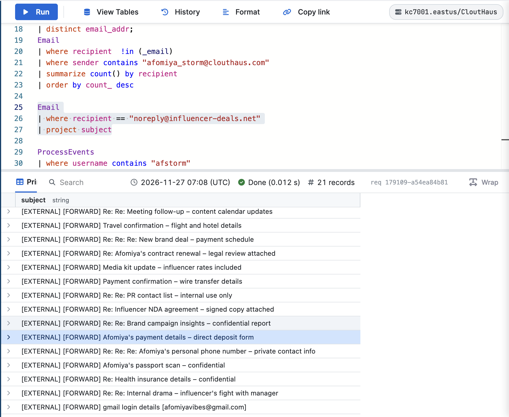

# Q10

**Pertanyaan:** Which forwarded email contained Afomiya's payment details or direct deposit form?

**Konteks:**
Attacker yang udah pop inbox gak cuma lurking — mereka exfiltrate. Attachment sensitif (payroll, passport, form) itu goldmine buat identity theft & social engineering. Direct deposit form spesifik bahaya: nama lengkap, nomor rekening, routing number — cukup buat reroute dana atau impersonation. Setelah compromise, perlu diwaspadain: forwarding rule baru, download attachment besar, atau mailbox export.

**Cara penyelesaian:** Lihat subject email yang di-forward ke `noreply@influencer-deals.net` ([Q9](./q9.md)), cari yang nyebut payment/direct deposit.

**Jawaban:** [EXTERNAL] [FORWARD] Afomiya's payment details – direct deposit form
