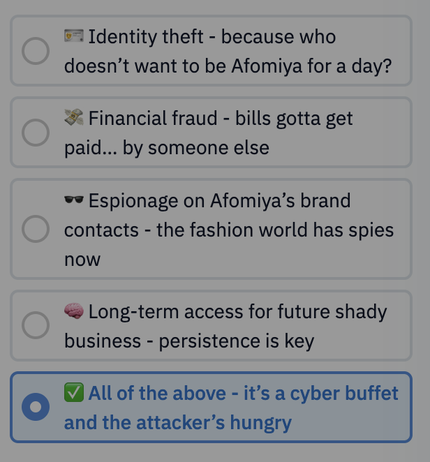

# Q13

**Pertanyaan:** Based on everything you've discovered, what do you think the attacker's true objective was?

**Pilihan:**
- Identity theft
- Financial fraud
- Espionage on Afomiya's brand contacts
- Long-term access for future shady business
- All of the above

**Konteks:**
Recap semua yang ketemu sepanjang investigasi: login mencurigakan, search OSINT buat recon, data grab (home address, Venmo, fake event lure), dan email forward yang nyolong passport scan, direct deposit form, sampe tax document.

**Cara penyelesaian:** Semua pilihan di atas (identity theft, financial fraud, espionage, long-term access) didukung bukti yang udah ditemuin — jadi tujuannya gabungan semua itu, bukan cuma satu.

**Jawaban:** All of the above - it's a cyber buffet and the attacker's hungry
