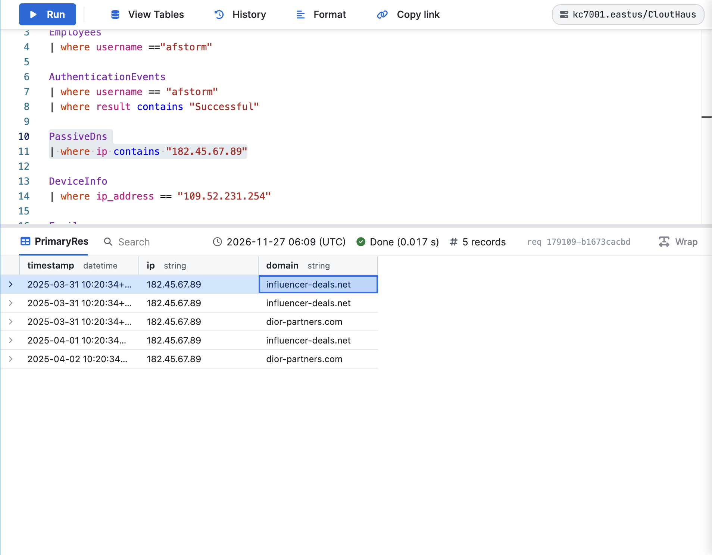
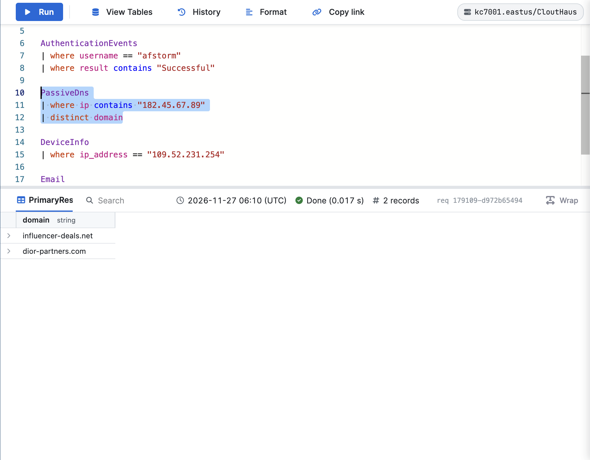

# Q2

**Pertanyaan:** What domains are associated with this IP? (enter one)

**Konteks:**
Udah ketemu IP yang dipake di login mencurigakan ke email Afomiya ([Q1](./q1.md): `182.45.67.89`). Attacker sering reuse server yang sama buat phishing/malware/C2 — pivot dari IP ke domain bantu map infrastruktur dan nemu aktivitas malicious lain.

**Cara penyelesaian:**
```kql
PassiveDns
| where ip == "182.45.67.89"
```

```kql
PassiveDns
| where ip == "182.45.67.89"
| distinct domain
```


⚠️ **Catatan:** ada 2 domain yang muncul buat IP ini, tapi cuma satu yang jadi jawaban yang benar.

**Jawaban:** influencer-deals.net
