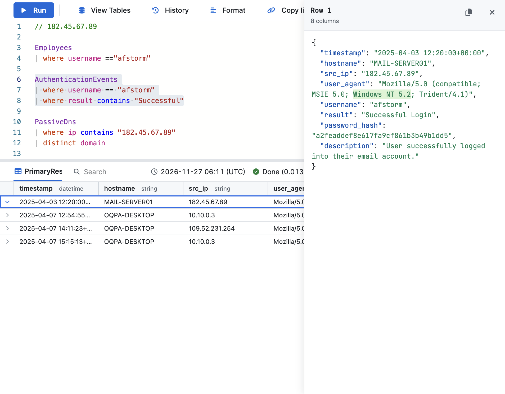

# Q3

**Pertanyaan:** What part of the User-Agent string indicates the suspicious browser and operating system? (Submit either the browser name/version or the operating system name/version.)

**Konteks:**
Login mencurigakan di [Q1](./q1.md) pake browser yang udah ancient banget (kemungkinan Internet Explorer lawas). Attacker suka pake User-Agent outdated biar bisa nyamar jadi user biasa atau lolos dari deteksi.

**Cara penyelesaian:** Lihat kolom User-Agent di log authentication event yang sama.

**Jawaban:** Windows NT 5.2
