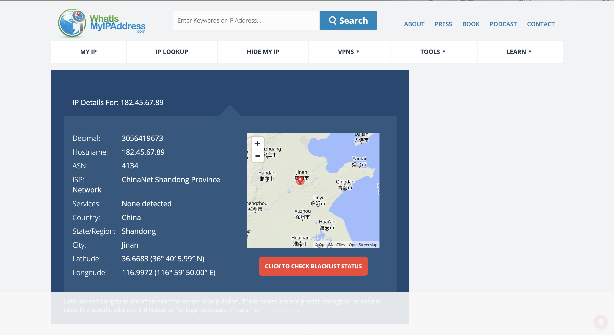

# Q4

**Pertanyaan:** What country did the login originate from?

**Konteks:**
IP address bisa bongkar banyak hal, termasuk kota asal login. Geolocation bantu nemuin anomali kayak login dari region yang gak wajar. Afomiya gak lagi terbang ke luar negeri buat brand shoot, jadi kalau login-nya dari belahan dunia lain, itu red flag.

| IP Address   | Location                          | Network         |
|--------------|------------------------------------|-----------------|
| 182.45.67.89 | Jinan, Shandong, China (CN), Asia  | 182.45.0.0/17   |

**Cara penyelesaian:** Lihat tabel geolocation IP `182.45.67.89` ([Q1](./q1.md)).

**Jawaban:** China
