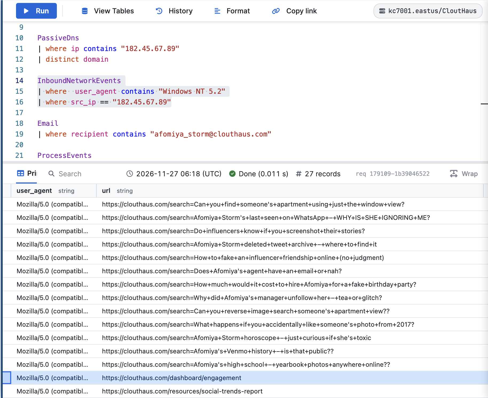
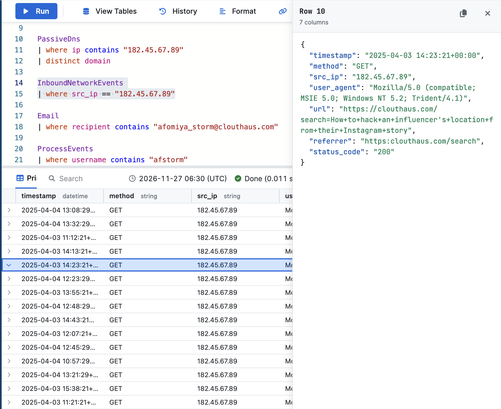

# Q5

**Pertanyaan:** According to the attacker's web search history on the site, what were they trying to hack?

**Konteks:**
`InboundNetworkEvents` log aktivitas incoming ke site perusahaan — bisa kebaca recon behavior sebelum attacker beneran bergerak. Attacker (IP `182.45.67.89`, [Q1](./q1.md)) ngelakuin banyak "search" ke site CloutHaus yang isinya stalking info pribadi Afomiya (WhatsApp last seen, deleted tweet archive, reverse image search apartment, Venmo history, yearbook photos, dll).

**Cara penyelesaian:**
```kql
InboundNetworkEvents
| where user_agent contains "Windows NT 5.2"
| where src_ip == "182.45.67.89"
```


Di antara 27 search itu, ada satu baris kunci jam `2025-04-03T14:23:21.000Z`:
```
https://clouthaus.com/search=How+to+hack+an+influencer's+location+from+their+Instagram+story
```


Ini connect ke Section 1 (Q&A Instagram Story pas Afomiya lagi di pesawat) — attacker nyoba cari cara nge-hack/nebak **lokasi** Afomiya dari Instagram story-nya, yang kaitannya sama security question (KBA) yang dia jawab tanpa sadar pas Q&A session.

**Jawaban:** location
