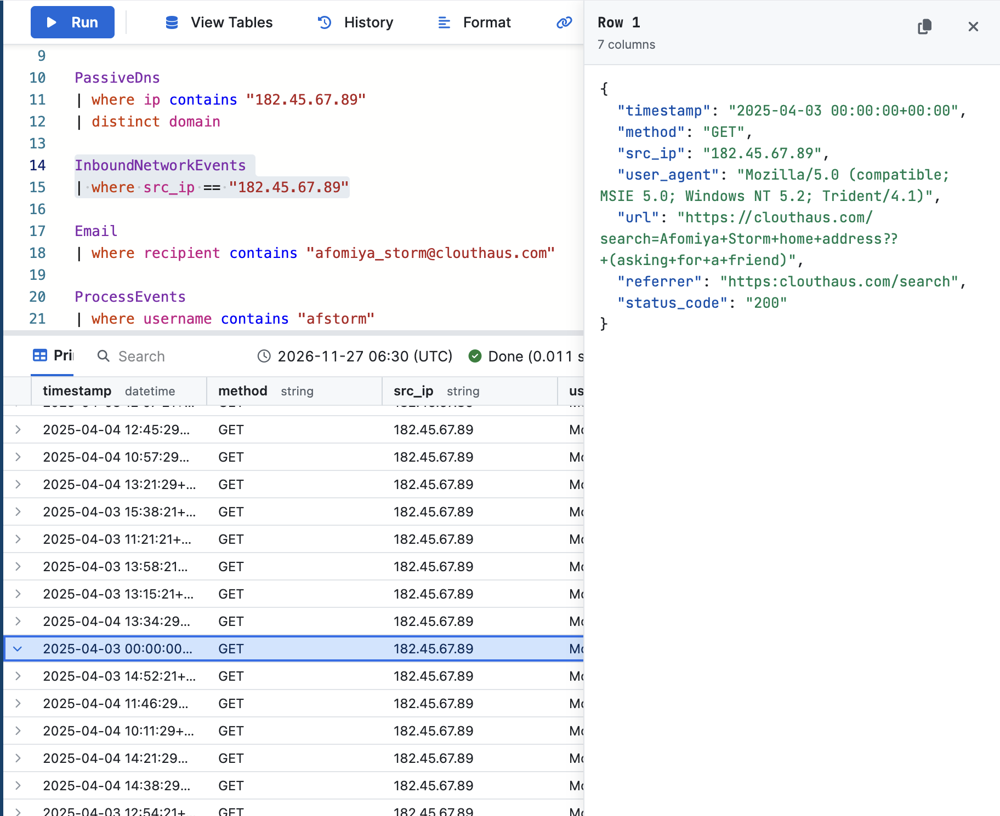

# Q6

**Pertanyaan:** According to another search log, what kind of personal info were they sneakily trying to uncover (and pretending to ask "for a friend")?

**Konteks:**
Attacker pake modus pretexting "nanya buat temen" buat gali info pribadi Afomiya — classic OSINT/targeted recon, biasanya buat bahan phishing, social engineering, atau account compromise lanjutan.

**Cara penyelesaian:** Cari row search log lain (masih dari IP `182.45.67.89`, [Q1](./q1.md)) yang frasanya kayak "for a friend".

**Jawaban:** home address
