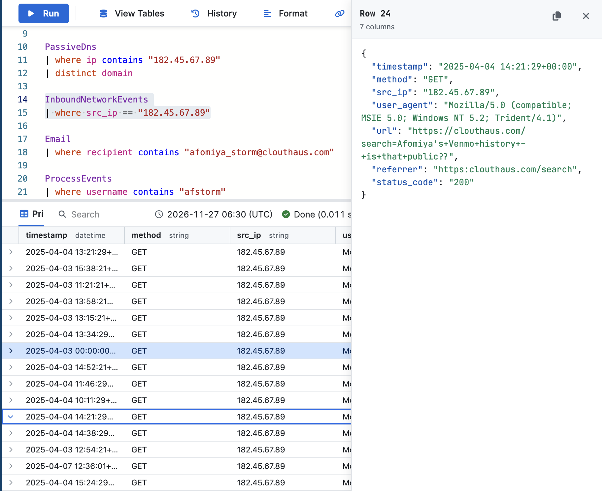
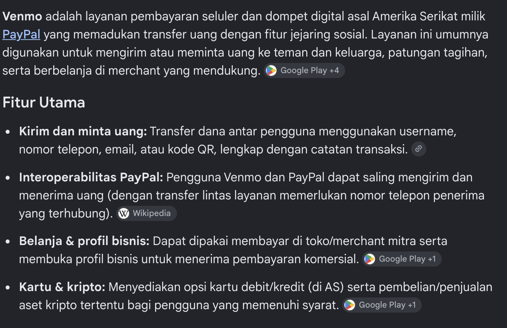

# Q7

**Pertanyaan:** What kind of account or app does that log suggest they were targeting?

**Konteks:**
Payment platform bisa kebuka transaction history, username, dan detail pribadi kalau gak diset private. Buat threat actor, ini goldmine — nunjukin siapa yang dibayar, kapan, kenapa, kadang di mana. Salah satu log nunjukin attacker nge-snoop transaction history Afomiya — bukan sekadar curiosity, ini targeted profiling.

**Cara penyelesaian:** Cari row search log (masih dari IP yang sama) yang nyebut transaction history/payment app.

**Jawaban:** Venmo
