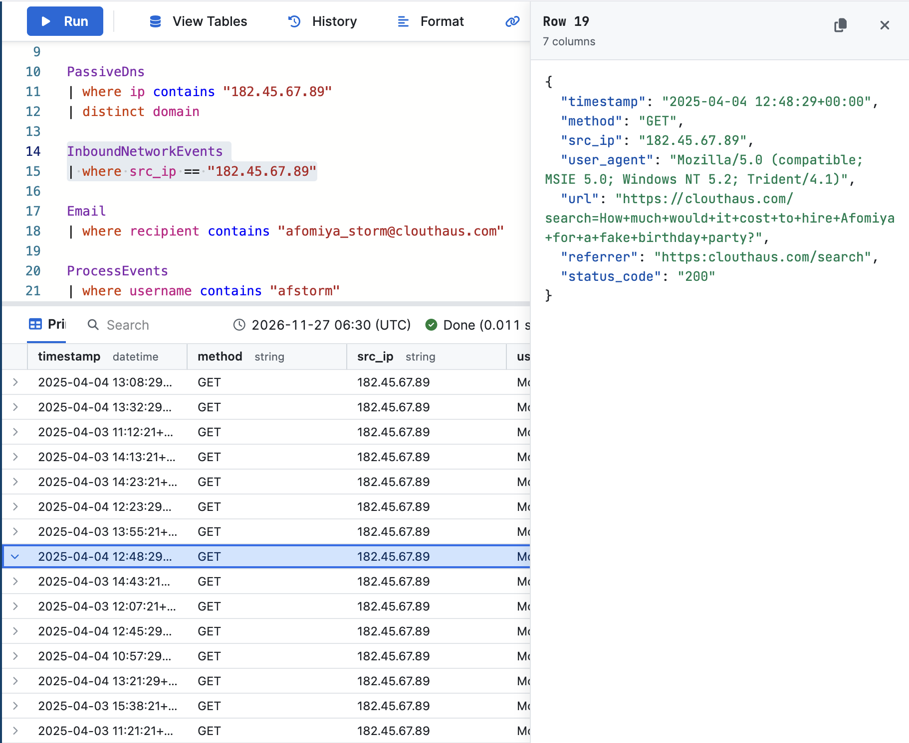

# Q8

**Pertanyaan:** Based on another search, what shady and fake event were they pretending to plan as a way to lure Afomiya?

**Konteks:**
Attacker sering mancing target pake fake job/event/gig — social engineering yang blend OSINT dengan emotional manipulation. Event-based lure efektif banget buat influencer/public figure yang bergantung sama partnership & appearance buat kerjaan. Trust itu yang dieksploitasi.

**Cara penyelesaian:** Cari row search log lain yang nunjukin rencana event palsu buat Afomiya.

**Jawaban:** birthday party
