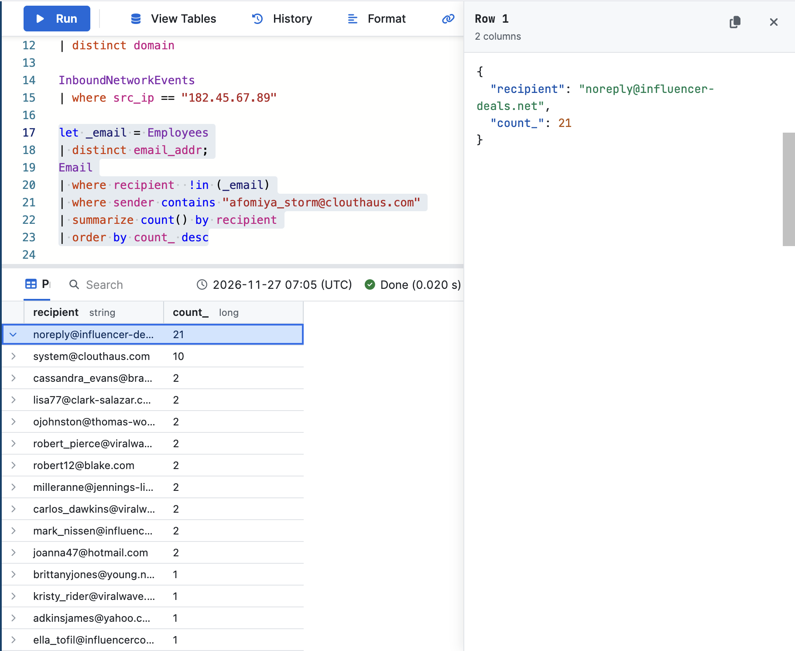

# Q9

**Pertanyaan:** What external email address received messages forwarded from Afomiya's account?

**Konteks:**
Attacker yang udah compromise email sering auto-forward pesan sensitif ke dirinya sendiri — teknik exfiltration yang stealthy & persistent (gak perlu login balik). Common di Business Email Compromise (BEC), espionage, APT.

**Cara penyelesaian:**
Query awal buat cari email keluar dari akun Afomiya ke address eksternal cuma ngasih ~200 hasil (kebanyakan email bisnis normal ke brand partner). Supaya ketauan address yang paling mencurigakan, agregat jumlah email per recipient:
```kql
let _email = Employees
| distinct email_addr;
Email
| where recipient !in (_email)
| where sender contains "afomiya_storm@clouthaus.com"
| summarize count() by recipient
| order by count_ desc
```


Address paling dominan muncul (`noreply@influencer-deals.net`) domainnya sama persis kayak domain yang ketemu di [Q2](./q2.md) — satu infrastruktur sama IP mencurigakan `182.45.67.89`. Ini confirm auto-forward rule yang dipasang attacker buat exfiltrate email Afomiya ke infrastrukturnya sendiri.

**Jawaban:** noreply@influencer-deals.net
