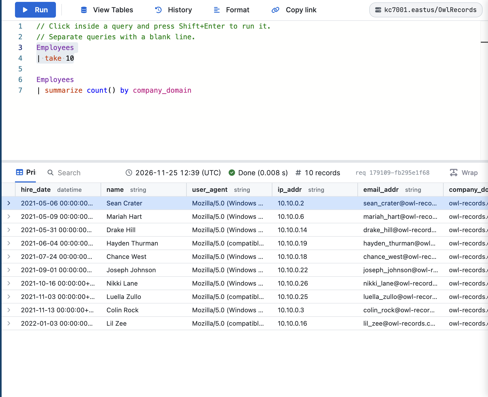
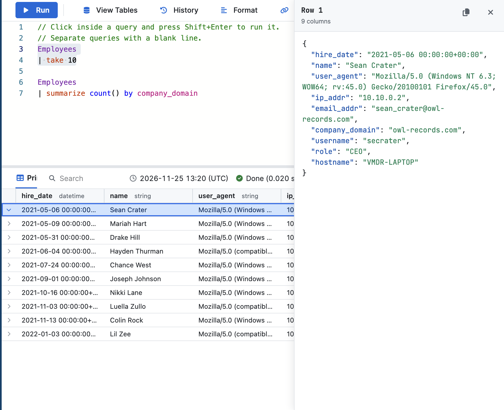
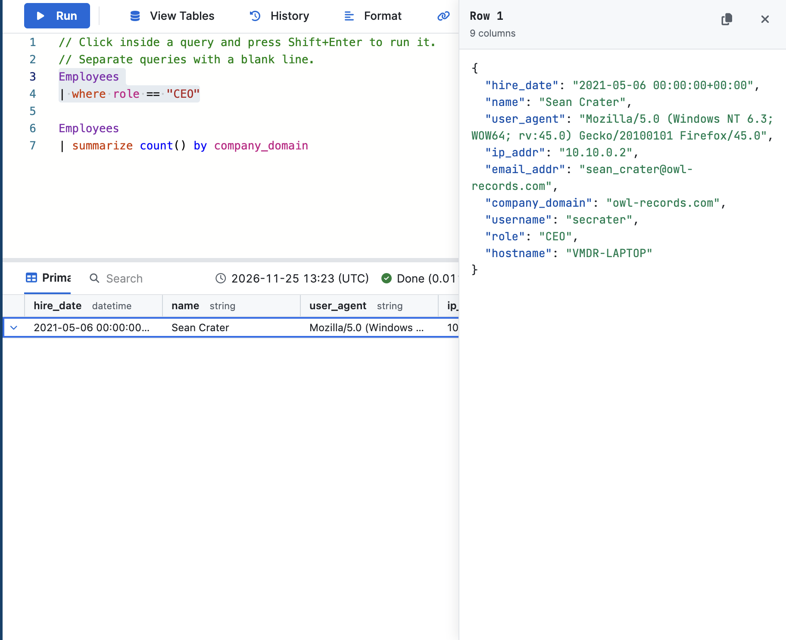

# Q4

**Pertanyaan:** What is the name of the OWL Records CEO?

**Konteks:**
Mulai pakai KQL (Kusto Query Language) buat query data. Contoh basic:
```kql
Employees
| take 10
```
Lalu query lebih spesifik buat cari CEO OWL Records:
```kql
Employees
| where role == "CEO"
```
Column beda-beda tiap table; di `Employees` ada `role`, `hire_date`, `name`, `user_agent`, `ip_address`, dll.

**Cara penyelesaian:**
1. 
2. 
3. Query `Employees | where role == "CEO"` buat langsung ke jawaban:
   

**Jawaban:** Sean Crater
