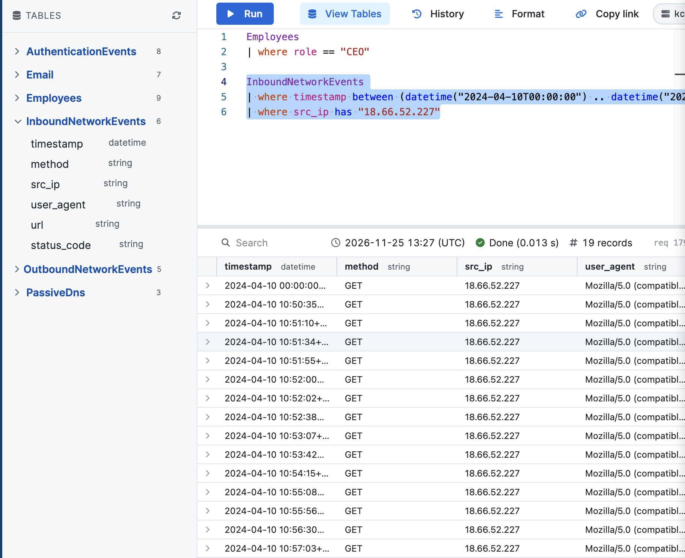

# Q5

**Pertanyaan:** How many results (rows) did you get back?

**Konteks:**
Cari browsing activity ke website OWL Records dari IP `18.66.52.227` (IP yang disebut si homeboy di Q3), pada rentang awal April sesuai tip.

**Cara penyelesaian:**
Query ke `InboundNetworkEvents`, filter timestamp 2024-04-10 s/d 2024-04-11 dan `src_ip` = `18.66.52.227`:
```kql
InboundNetworkEvents
| where timestamp between (datetime("2024-04-10T00:00:00") .. datetime("2024-04-11T00:00:00"))
| where src_ip has "18.66.52.227"
```


**Jawaban:** 19
