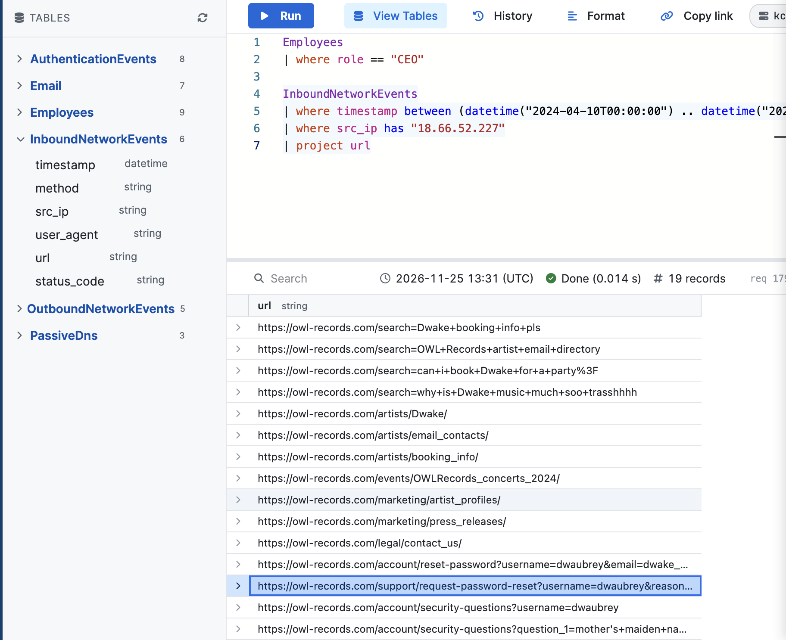

# Q6

**Pertanyaan:** What piece of information were they looking to get for Dwake? (two words - might be used for communication)

**Konteks:**
Hasil query Q5 nunjukin orang browsing/searching info soal artist OWL Records, terutama Dwake. Lihat kolom `url` buat tau apa yang dicari si attacker.

**Cara penyelesaian:**
Query `InboundNetworkEvents` yang sama (IP `18.66.52.227`, rentang 2024-04-10 - 2024-04-11), tambah `project url`:
```kql
InboundNetworkEvents
| where timestamp between (datetime("2024-04-10T00:00:00") .. datetime("2024-04-11T00:00:00"))
| where src_ip has "18.66.52.227"
| project url
```


**Jawaban:** email address
